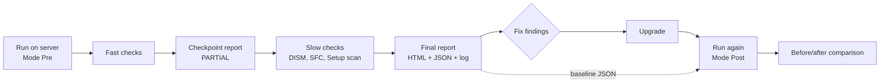
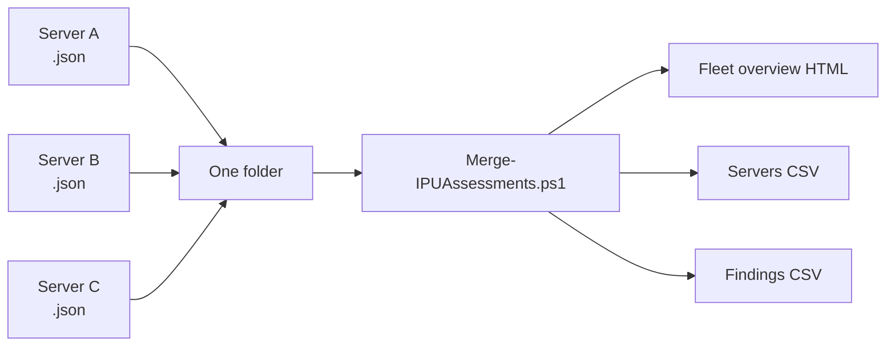
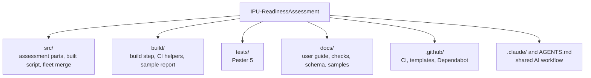

# IPU-ReadinessAssessment

Read-only **in-place upgrade (IPU) readiness assessment** for Windows Server. Run it on a server
before an upgrade to **Windows Server 2025** (default), **2022** or **2019**, and get one overall status, a prioritised
list of what to fix, and a self-contained report. Run it again afterwards to check the server against
its own pre-upgrade baseline.

[](https://github.com/JeanKadang/IPU-ReadinessAssessment/actions/workflows/ci.yml)


## What you get

| Output | For | File |
|---|---|---|
| HTML report | People: findings, what to do, evidence | `<Computer>-IPU-Assessment.html` |
| Result JSON | Tools, fleet roll-ups, post-upgrade baseline | `<Computer>-IPU-Assessment.json` |
| Log | Troubleshooting the assessment script | `<Computer>-IPU-Assessment.log` |
| One result line | The automation platform (OpenText SA) | stdout, semicolon-delimited |
| Evidence copies | Putting a server back by hand: Group Policy and RDP evidence, IIS and network configuration, print server backup | `C:\Temp\IPU-Evidence\<topic>\` (not redacted) |

Default output folder: `C:\Temp\IPU-Assessment`. Evidence copies go to a separate folder on purpose, so the report folder can be collected and shared; see [Sharing a report](#sharing-a-report).

For many servers, `Merge-IPUAssessments.ps1` turns all the result JSON files into a fleet overview:

| Output | For | File |
|---|---|---|
| Fleet overview | Whole estate at a glance, worst server first | `IPU-Fleet-Overview.html` |
| Servers sheet | One row per server, for Excel | `IPU-Fleet-Servers.csv` |
| Findings sheet | Every finding, one row each, for filtering | `IPU-Fleet-Findings.csv` |
| End-of-life products | Every product with an end-of-life date, its verdict and the servers | `IPU-Fleet-Eol.csv` |

## How it works



It answers four questions:

1. **Is the path supported?** Source release, edition and target, per Microsoft's installation-media table.
2. **Will the server and its workloads survive?** SQL, Exchange, IIS, RDS, clustering, VMware, drivers, agents, antivirus/EDR, backup, certificates, removed or deprecated features.
3. **Is Windows healthy enough?** Pending reboot, patch age, activation, disk space, DISM component store, SFC.
4. **Did anything get lost afterwards?** Services, ports, routes, network adapters, printers, shares, Group Policy, hosts entries, applications, features and tasks, compared with the pre-upgrade baseline.

Cluster nodes and domain controllers are not a standard in-place upgrade. They get a short report with the facts needed to choose a plan, and the status `SPECIAL` (see the [user guide](docs/user-guide.md#special-cluster-nodes-and-domain-controllers)).

## Get the script

Take it from the [latest release](https://github.com/JeanKadang/IPU-ReadinessAssessment/releases/latest), not from
`main`: a release is tested in CI and has `SHA256SUMS.txt`. Before you upload the script to OpenText SA, check
that its hash matches the one in `SHA256SUMS.txt`:

```powershell
Get-FileHash .\Windows-IPU-Readiness-Assessment.ps1 -Algorithm SHA256
```

The scripts are not code-signed yet (#14). If your servers enforce signed scripts, sign them with your
organisation's certificate after checking the hash.

## Quick start

Run in an elevated session on the server (Windows PowerShell 4.0+):

```powershell
# Pre-upgrade assessment, target Windows Server 2025
.\src\Windows-IPU-Readiness-Assessment.ps1

# Target 2022 instead
.\src\Windows-IPU-Readiness-Assessment.ps1 -TargetServerVersion 2022

# After the upgrade: compare with the pre-upgrade baseline
.\src\Windows-IPU-Readiness-Assessment.ps1 -AssessmentMode Post
```

Then open `C:\Temp\IPU-Assessment\<Computer>-IPU-Assessment.html`.

### Many servers: fleet overview

Collect each server's `.json` result into one folder, then run on an admin workstation (not on the servers):

```powershell
.\src\Merge-IPUAssessments.ps1 -InputFolder 'D:\IPU\Results'
```



Options (`-OutputFolder`, `-Mode Pre|Post|All`, `-Delimiter`) are in the [user guide](docs/user-guide.md#9-combining-many-servers-fleet-overview).

Full parameter reference, status meanings, SA usage and troubleshooting: **[User guide](docs/user-guide.md)**.
What each of the 38 checks looks at and can report: **[Checks reference](docs/checks.md)**. What a report looks like: [sample report](docs/samples/sample-report.html) (fictional server).

## Reading the result

| Status | Meaning | Counts toward overall |
|---|---|---|
| `SPECIAL` | Not a standard in-place upgrade (cluster node, domain controller): needs its own plan | Yes, outranks all others |
| `BLOCKER` | Do not upgrade until resolved | Yes |
| `ACTION` | Must be done as part of the change | Yes |
| `WARNING` | Plan for it | Yes |
| `MANUAL` | Cannot be proven by the script; a person must check | Yes |
| `OK` | Checked, fine | No |
| `INFO` | For visibility | No |

The overall status is the most severe finding, in the order of the table. Only findings count; observations and evidence do not.

## Sharing a report

Reports describe a server in detail, so redact a copy before it leaves the team:

```powershell
# Redact while collecting: the report and JSON on disk are already redacted
.\src\Windows-IPU-Readiness-Assessment.ps1 -RedactReport 1

# Redact reports that already exist, in place next to the originals
.\src\Windows-IPU-Readiness-Assessment.ps1 -RedactExisting 'D:\IPU\Results'
```

Both write a `DO-NOT-SHARE-...-REDACTION-KEY.csv` that maps each placeholder (`HOST-1`) back to the real name, so questions about a shared copy can be answered. Keep the key in the team and share only the `REDACTED-*` files. Redaction is best effort: read the copy before sharing it. The evidence copies are never redacted. Details: [user guide, Sharing a report](docs/user-guide.md#sharing-a-report-redaction).

## Safety

The assessment is **non-remediating**. It never installs, removes or reconfigures anything.

- DISM runs `/ScanHealth` only; SFC runs `/verifyonly` only.
- `LGPO.exe` is used only with `/b` (backup) and `/parse`, never `/g` or `/m`.
- No `Win32_Product` query.
- Side effects, by design: report, log, JSON and evidence files are written. Only when `-TargetMediaPath` is set is an ISO mounted and dismounted, and Setup's compatibility scan creates `C:\$WINDOWS.~BT`.
- A crashed check is reported as `MANUAL`: absence of findings in that area is not evidence of readiness.

> Reports describe a server in detail (ports, tasks, certificates, agents). Treat them as sensitive. Folders the script creates are limited to SYSTEM and Administrators; an existing folder keeps its permissions, and the report warns if it is readable by ordinary users. Opt out with `-RestrictOutputAcl $false`.

## Repository layout



| Path | Contents |
|---|---|
| `src/` | `Windows-IPU-Readiness-Assessment.ps1` (the one file that runs on each server; **built**, do not edit by hand), `Merge-IPUAssessments.ps1` (fleet overview, runs on a workstation), `Get-IPUEolStatus.ps1` (end-of-life status of a product version, runs on a workstation) |
| `src/assessment/` | The parts the assessment script is built from, in the order of `manifest.txt` |
| `build/` | `Build-Script.ps1` (parts to single file), CI helpers (tests, lint, smoke test), `New-SampleReport.ps1`, `Sync-Skills.ps1` |
| `docs/build.md` | How the build works, in plain words |
| `tests/` | Pester tests: decision rules, every check against a simulated server, reports, redaction, and the fleet merge |
| `docs/user-guide.md` | How to run the assessment script and read its report |
| `docs/checks.md` | What every check looks at and can report |
| `docs/result-schema.md`, `docs/result-schema.json` | Result JSON format (`IPU-Assessment/1`) and its JSON Schema |
| `docs/samples/` | Synthetic sample report and result, built by `build/New-SampleReport.ps1` |
| `docs/adr/` | Architecture decision records |
| `docs/review/` | Repository quality reviews (newest: `audit-review-claude-v3.md`) and the code-level script evaluation (`script-evaluation-4.5.3.md`) |
| `.github/` | CI, release and labeler workflows, issue forms, PR template, Dependabot, release notes config |
| `.claude/`, `AGENTS.md`, `CLAUDE.md` | Shared GitHub workflow skills, plugin settings and assistant guidance (see [CONTRIBUTING](CONTRIBUTING.md#working-with-claude-code)) |

## Development

```powershell
# Edit the parts in src/assessment/, then rebuild the single file (commit both)
pwsh .\build\Build-Script.ps1

# Run the tests (Pester 5)
Invoke-Pester .\tests -Output Detailed

# Or run the checks CI runs (lint and tests), with one summary
pwsh .\build\Invoke-Local.ps1
```

`Invoke-Local.ps1` also runs the smoke test and regenerates the sample (`-Task All`); see
[CONTRIBUTING](CONTRIBUTING.md#run-the-ci-checks-locally).

Never edit `src/Windows-IPU-Readiness-Assessment.ps1` by hand: CI fails when it does not match its parts ([ADR 0002](docs/adr/0002-source-in-parts-built-into-one-file.md), [docs/build.md](docs/build.md)).

Tests load the script in library mode (`IPU_ASSESSMENT_LIBRARY_ONLY=1`): functions only, nothing is collected
from the machine. They need Windows and run the same in an elevated or a normal (unelevated) session: CI runs the
whole suite both ways (#126). Add `-ExcludeTagFilter Integration` to skip the tests that
start real processes. If your machine enforces a signed-script policy, start the session with
`pwsh -ExecutionPolicy Bypass` (process scope only). Details: [user guide, Running the tests](docs/user-guide.md#13-running-the-tests).

New contributor? Start with the [Git setup guide](docs/git-setup.md). Contributing workflow and conventions: [CONTRIBUTING.md](CONTRIBUTING.md). Security reports: [SECURITY.md](SECURITY.md).
Version history: [CHANGELOG.md](CHANGELOG.md).

## License

GPL-3.0. See [LICENSE](LICENSE).

### Licence FAQ

A plain-language summary for people who use the scripts. It is not legal advice; the licence text in
[LICENSE](LICENSE) is what counts.

- **Can we run it on our servers, through our own automation (for example OpenText Server Automation)?** Yes. Running
  the scripts, in your own organisation or on a customer's servers you manage, needs no permission and no payment.
- **Can we change it for our own use?** Yes. Changes you keep inside your organisation carry no obligation.
- **Can we give a copy to someone else (a customer, a partner)?** Yes, as long as the copy keeps the GPL-3.0 terms: the
  licence text goes with it, and the recipient gets the same rights you got. The scripts are plain text, so the source
  is the file itself.
- **Can we give away a modified copy?** Yes, under GPL-3.0 as well, with a note of what you changed. You cannot hand it
  on under a more restrictive licence.
- **Can we build the scripts into a product that we sell and keep closed?** No. That would need a different licence from
  the copyright holders (open an issue to talk about it).
- **What about the reports?** The server data in a report is yours. The fixed text and layout the script adds come from
  the script; the copyright holders do not apply the GPL's conditions to a report you share with your team or your
  customer. The redaction options (`-RedactReport`, `-RedactExisting`) are for hiding names before you share one.
- **Does the end-of-life data change this?** The EOL snapshot from [endoflife.date](https://endoflife.date) is under that
  project's MIT licence; the notice travels in the EOL snapshot (see [ADR 0003](docs/adr/0003-end-of-life-lookup-architecture.md)).
