# Evaluation of `Windows-IPU-Readiness-Assessment.ps1`

| | |
|---|---|
| **Requested by** | Jean |
| **Reviewed** | 2026-10-22 |
| **Subject** | `src/Windows-IPU-Readiness-Assessment.ps1`, collector version 4.3.0 (released 2026-10-08), 4,243 lines |
| **Method** | Static reading of the file header, parameters, detection patterns, core, selected decision rules, report/JSON writer, redaction, main flow, and the CI workflow. `docs/checks.md` was used as the map of the 33 checks. |
| **Not done** | The script and the Pester tests were **not run**: this review environment has no PowerShell. Check bodies (section 5) were sampled, not read line by line. |
| **Evidence labels** | **READ** = seen in the code. **DOCS** = taken from the repo's own documentation. **PLAUSIBLE** = inferred from reading, not exercised. |

Related reviews already in the repo: `docs/review/audit-review-Claude.md` and `audit-review-claude-v2.md` cover the whole repository. This file looks at the script only.

---

## Contents

1. [Verdict](#1-verdict)
2. [What the script is](#2-what-the-script-is)
3. [Architecture](#3-architecture)
4. [Run flow](#4-run-flow)
5. [Checks](#5-checks)
6. [Result model and status roll-up](#6-result-model-and-status-roll-up)
7. [Scorecard](#7-scorecard)
8. [Strengths](#8-strengths)
9. [Risks and weaknesses](#9-risks-and-weaknesses)
10. [Hard-rule compliance](#10-hard-rule-compliance)
11. [Recommendations](#11-recommendations)
12. [Limits of this evaluation](#12-limits-of-this-evaluation)

---

## 1. Verdict

**A well-engineered, defensive collector. Fit for its purpose.** The design choices that matter most for a
read-only readiness tool are the right ones, and they are visible in the code rather than only claimed:

- An error never becomes a clean result. `Invoke-Check` runs every check with `$ErrorActionPreference = 'Stop'`
  and turns an exception into a `MANUAL` row in *Collector coverage*. (READ)
- Decision logic is separated into pure functions, so the rules can be tested without a server. (READ)
- External tools run with a timeout, captured bytes and a process-tree kill. (READ)
- The report is written in two stages (partial checkpoint, then final) and atomically via a `.writing` file. (READ)

The main weaknesses are not defects but **maintainability and decay**: one 4,243-line file with a roughly
1,330-line registration function, hard-coded Microsoft support data that goes stale, and regex-based redaction
that is best effort by nature. None is urgent. Section 11 ranks what to do about them.

| Area | Rating |
|---|---|
| Safety (non-remediating) | Strong |
| Failure visibility | Strong |
| Testability of rules | Strong |
| Compatibility (PS 4.0 to 7) | Good, depends on CI |
| Maintainability of the single file | Fair |
| Data freshness | Fair, needs a review cadence |
| Redaction | Good for its stated purpose, best effort |

---

## 2. What the script is

A read-only Windows Server in-place upgrade (IPU) readiness assessment. It runs once per server, normally from
OpenText Server Automation (SA) as LocalSystem, and produces four things:

| Output | Purpose |
|---|---|
| `<host>-IPU-Assessment.html` | Self-contained report for people |
| `<host>-IPU-Assessment.json` | Same results for tools; baseline for the post-upgrade run |
| `<host>-IPU-Assessment.log` | Collector log |
| One semicolon-delimited line on stdout | Result for SA (`RunStatus`, `AssessmentStatus`, paths, duration) |

A second mode, `-AssessmentMode Post`, compares the upgraded server with its own pre-upgrade JSON.

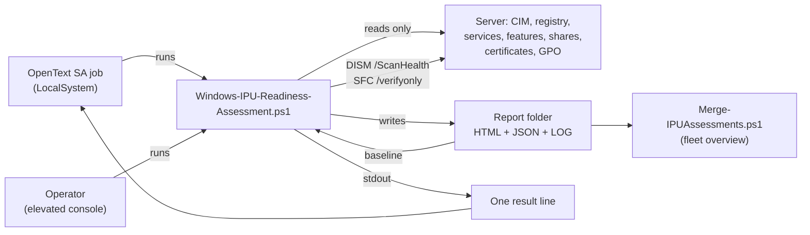

---

## 3. Architecture

The file is organised in seven numbered sections, announced in its own header. Line counts below are measured
from the section banners.

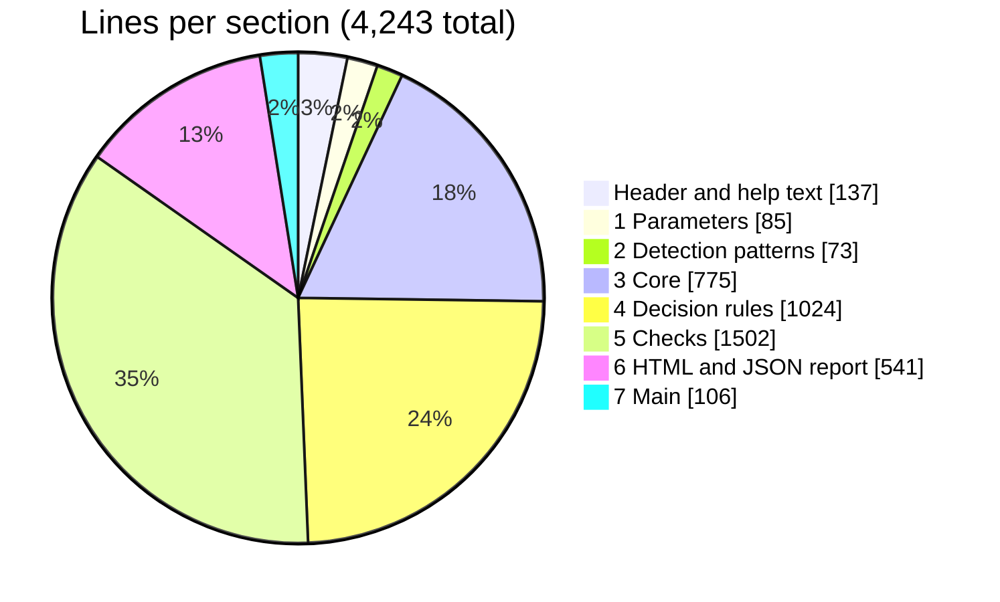

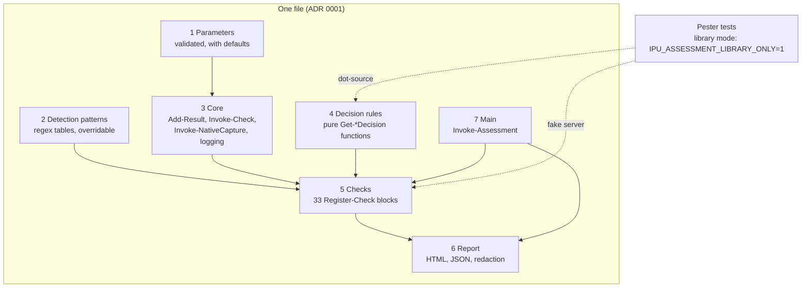

**Why a single file.** OpenText SA Ad-Hoc Scripting runs one file. ADR 0001 records this and forbids splitting
into modules without a superseding ADR. The cost is the size; the script mitigates it with the numbered
sections and by keeping decisions in section 4. (READ, DOCS)

**Test seam.** Setting `IPU_ASSESSMENT_LIBRARY_ONLY=1` makes the script `return` before any collection, so tests
can dot-source the functions. Tests total about 3,900 lines against about 4,400 lines of source (script plus
merge script), roughly 0.9 : 1. (READ, line counts)

---

## 4. Run flow

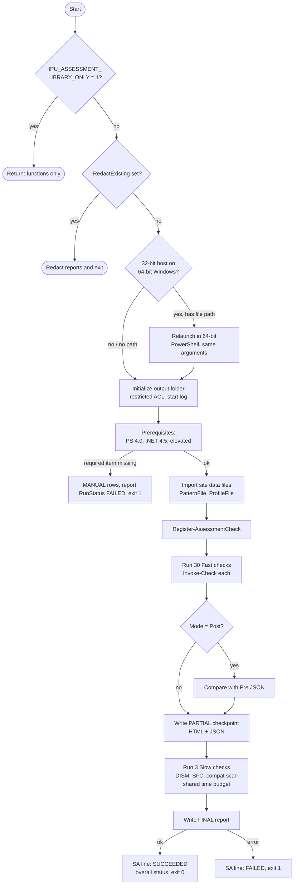

Points worth noting:

- **Exit code vs readiness.** The process exits `0` when the run *completed*, even if the server has a
  `BLOCKER`. Readiness is carried in the `AssessmentStatus` column of the SA line. This is a sound split
  between "the tool worked" and "the server is ready", but anyone wiring this into a pipeline must read the
  column, not the exit code. (READ)
- **Checkpoint.** If SA kills the job during the slow checks, the partial HTML and JSON from the checkpoint
  already exist. (READ)
- **Budget.** DISM and SFC share `SlowCheckBudgetMinutes` (default 50). A slow check with under one minute
  left is not started and is recorded as `MANUAL` with outcome `Skipped`. (READ)

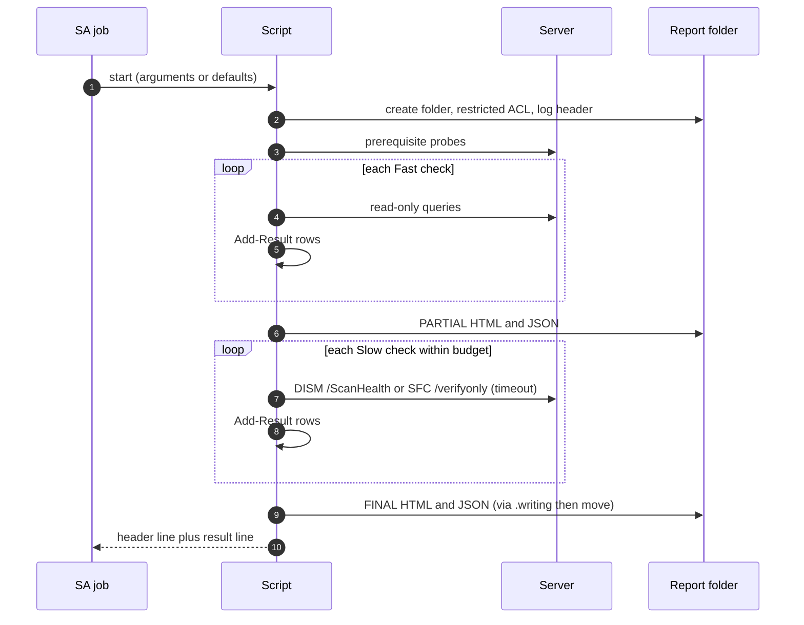

---

## 5. Checks

33 checks: 30 Fast, 3 Slow (DOCS: `docs/checks.md`; ids confirmed in the source). They are registered as
`Register-Check -Id ... -Script { ... }` blocks inside `Register-AssessmentCheck`.

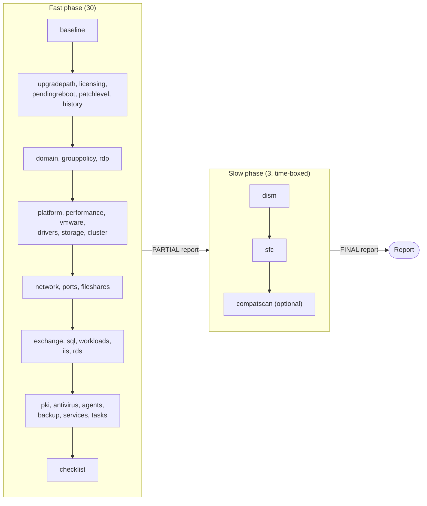

`baseline` runs first and fills `$script:Data` (OS, services, applications, features, drivers, snapshot). Most
other checks read from it, so a failed `baseline` degrades everything after it. That failure is still visible as
a `MANUAL` row. (READ)

### Check lifecycle

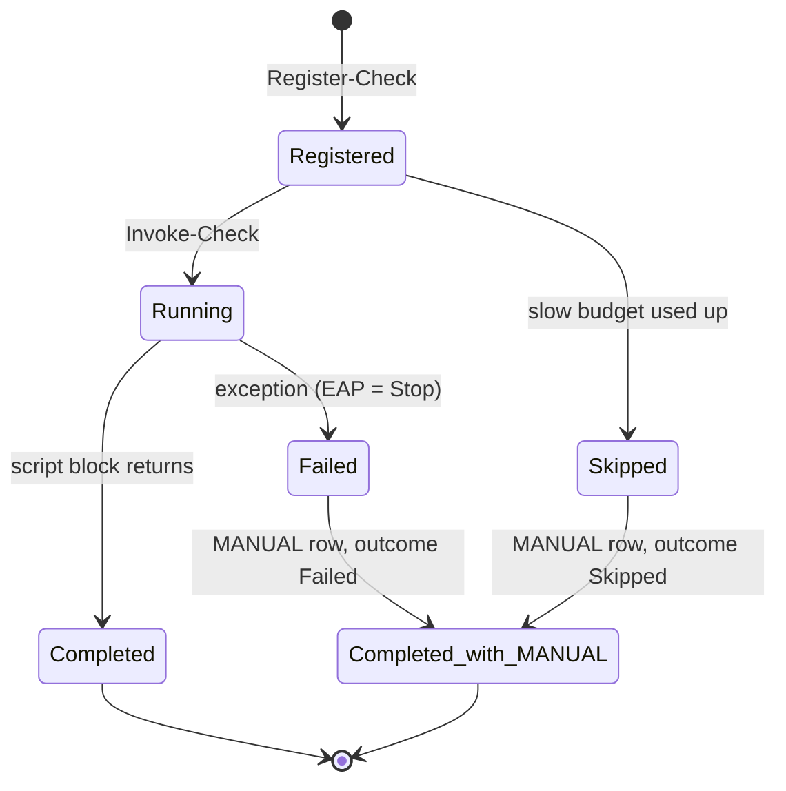

The important property: there is **no path from an exception to a silent result**. A check either completes, or
leaves a `MANUAL` row naming it. (READ: `Invoke-Check`, `Add-SkippedSlowCheck`)

---

## 6. Result model and status roll-up

Every observation is one `Add-Result` call. Area names are validated against `$script:AreaMap`, so a typo throws
instead of producing an orphan row. Links must be `https://`, and a `-Command` must declare `Check` (read-only)
or `Change` (run in the change window). The script only shows commands; it never runs them. (READ)

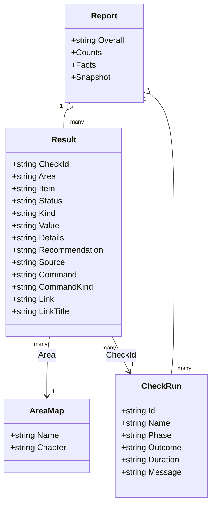

**Status vocabulary:** `BLOCKER`, `ACTION`, `WARNING`, `MANUAL`, `OK`, `INFO`.
**Kinds:** `Finding`, `Observation`, `Checklist`, `Evidence`.

Only rows of kind `Finding` with one of the first four statuses count towards the overall status. The roll-up
takes the worst one, in the order below (`Get-OverallStatus`, READ):

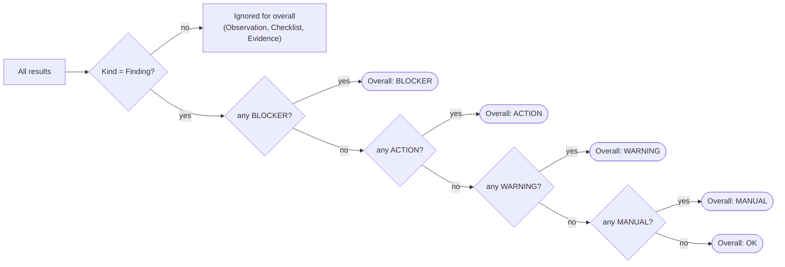

`MANUAL` ranks below `WARNING` but above `OK`. That is deliberate and correct for this tool: "could not be
checked" must never read as "ready".

---

## 7. Scorecard

Scores are my judgement, 1 (weak) to 5 (strong), with the evidence behind each.

| Dimension | Score | Evidence |
|---|---|---|
| Safety / non-remediation | 5 | Only `/ScanHealth` and `/verifyonly`; `LGPO` only `/b` and `/parse`; no `Win32_Product`; side effects listed in the header. Grep found no `Win32_Product` use beyond the comment that forbids it. (READ) |
| Failure visibility | 5 | `Invoke-Check` converts errors to `MANUAL`; prerequisites stop with a clear message; skipped slow checks recorded; log write failures counted. (READ) |
| Testability | 4 | Pure decision functions; library mode; every check has a fake-server test per `docs/checks.md`. Not re-verified by running. (READ, DOCS) |
| Robustness of external tools | 4 | Timeout, raw-byte capture for UTF-16 `sfc.exe` output, child-tree kill, 15-second pipe cap. Argument quoting is simple (see 9.4). (READ) |
| Security of outputs | 4 | Report folders restricted to SYSTEM and Administrators; existing folders never changed; atomic write; opt-in redaction. Log is not redacted (documented). (READ) |
| Compatibility | 4 | `#requires -Version 4.0`; ASCII only, CRLF; CI covers PS 5.1 and 7 on Server 2025 and 2022, plus a 2012 R2 / PS 4.0 syntax check per the changelog. 4.0 itself cannot be run in CI. (READ, DOCS) |
| Maintainability | 3 | Clear sections and comments, but one file, a ~1,330-line `Register-AssessmentCheck`, long lines (388 flagged by `file`). (READ) |
| Data freshness | 3 | Support dates, upgrade paths, SQL matrix, VMware Tools minimum, removed-feature list are hard-coded. Correct today, will drift. (READ) |
| Operability in SA | 4 | Single result line with a fixed header; time budget; checkpoint report; parameters with defaults so no arguments are needed. (READ) |
| Documentation | 5 | Long header with purpose, safety, version history; user guide, checks reference, JSON schema, ADR. (READ, DOCS) |

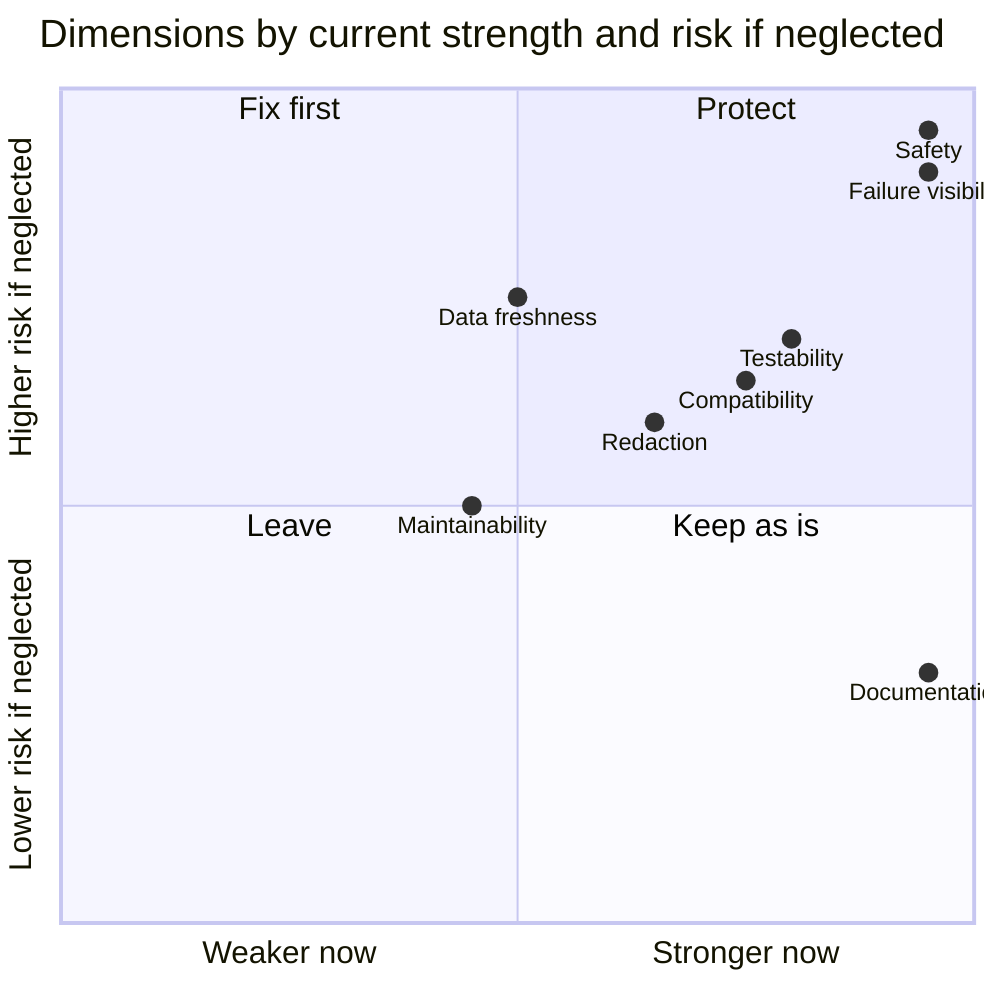

---

## 8. Strengths

1. **Errors cannot masquerade as success.** Covered above. This is the single most valuable property of the
   tool, and it is enforced centrally rather than check by check.
2. **Pure decision functions.** `Get-UpgradePathDecision`, `Get-SupportLifecycleDecision`, `Get-EditionDecision`,
   `Get-SqlSupportDecision`, `Get-DismVerdict`, `Get-SfcVerdict`, `Get-OverallStatus` and others take plain
   values and return plain objects. They are easy to test and review against Microsoft's tables. (READ)
3. **Time-boxing and checkpointing.** A hung DISM cannot hold the job forever, and a killed job still leaves a
   partial report. (READ)
4. **Validated parameters.** `ValidateRange`, `ValidateSet`, `ValidatePattern` and rooted-path `ValidateScript`
   on every setting stop bad input before anything runs. (READ)
5. **Site tuning without editing code.** `-PatternFile` and `-ProfileFile` let a site change detection patterns
   and thresholds. A file that cannot be used is reported as `MANUAL` and *nothing* from it is applied, which
   avoids a half-applied profile. (READ)
6. **Careful about 32-bit hosts.** A 32-bit PowerShell on 64-bit Windows would silently see redirected registry
   and file-system views. The script relaunches as 64-bit with all bound parameters, or flags it. (READ)
7. **Atomic, validated report write.** The HTML is checked for length, doctype and closing tag, written to
   `.writing`, then moved into place. (READ)
8. **Honest documentation of limits.** Redaction is "best effort - read before sharing"; the log is not
   redacted; a redacted result cannot be a baseline. These are stated at the parameter. (READ)

---

## 9. Risks and weaknesses

None of these is a confirmed defect. Each is labelled with how I know.

### 9.1 One very large registration function (maintainability)

`Register-AssessmentCheck` spans lines 2097 to 3424, about 1,330 lines holding 30 of the 33 check blocks, and
the checks section as a whole is 1,500 lines. Review diffs are hard to scope, and an error in one block can sit
far from its neighbours' context. ADR 0001 rules out modules, so the lever is **navigation**, not splitting:
region markers, an index comment at the top of the section, and keeping each check block short by moving logic
into section 4 pure functions. (READ)

### 9.2 Hard-coded vendor facts will go stale (data freshness)

Release end-of-support dates (`$script:ReleaseEndOfSupport`), supported upgrade paths, the SQL Server matrix, the
VMware Tools minimum (12.5.0 for 2025) and the removed/deprecated feature list are all literals in the script.
They were checked against Microsoft at release time per the changelog, but nothing in the script or CI flags
age. A Server 2025 servicing change or a new SQL cumulative update would not be noticed until someone reads the
page. (READ)

### 9.3 Swallowed errors are logged, not surfaced (failure visibility)

There are 37 `-ErrorAction SilentlyContinue` uses and 48 `Write-Swallowed` calls. `Write-Swallowed` writes a
`DEBUG` line to the log. That is good for forensics, but a reader of the HTML report cannot tell that an
*optional* query failed. The distinction "not found" vs "could not look" is preserved only in the log. The
script already does this better for log-write failures (`LogWriteFailures` is counted for the report).
**PLAUSIBLE:** a similar counter, shown in *Collector coverage* when above zero, would extend the existing
principle at low cost.

### 9.4 `Invoke-NativeCapture` argument quoting (low)

Arguments containing whitespace are wrapped in quotes, but embedded quotes and a trailing backslash before the
closing quote are not escaped. Today every call passes fixed or locally derived arguments, so I found no
exploitable path. **PLAUSIBLE:** it becomes a trap if a later change passes a user-supplied path
(for example `TargetMediaPath`) through the same function. A short comment on the limit, or a test for a path
with a trailing backslash, would close it.

### 9.5 Regex redaction is inherently best effort

`Protect-ReportText` applies about twenty ordered regex passes: collected literals, local group members,
thumbprints, certificate subjects, DC components, MACs, SIDs, `DOMAIN\user`, UPNs, FQDNs, TLD-based host names,
NetBIOS names, GPO link paths, IPv4, IPv6. The order matters and is documented in comments.

- A name that is not a collected literal, has no recognised TLD and is not in `DOMAIN\user` form can survive.
  The script says so. (READ)
- **PLAUSIBLE:** the passes run per string, and compiled-regex caching depends on the .NET static cache. On a
  server with thousands of application or port rows this could be slow. I did not measure it; the smoke test
  would show it.
- The CHANGELOG records a real false alarm in the leak check on Windows Server 2022 (#114), so the area has had
  live issues. Continued regression tests on both images are the right mitigation, and CI now does that.

### 9.6 Defaults that are site decisions

`NumberCultureName = 'da-DK'`, `BlockDomainControllerIPU = $true`, `C:\Temp\...` paths and `MinimumCFreeGB = 40`
are project values, not Microsoft rules. The parameter comments say so for the thresholds. `da-DK` formats
numbers with decimal commas in the report, which a reader outside Denmark may misread. Both can be overridden by
profile; the default is simply Danish. (READ)

### 9.7 Exit code does not carry readiness

Described in section 4. It is a design choice, not a flaw, but it is an easy thing to get wrong in a downstream
job. The user guide should keep saying it prominently. (READ)

### 9.8 Windows PowerShell 4.0 is verified by syntax check, not by execution

CI runs the real tests on 5.1 and 7, and checks `src/` for 4.0 compatibility (PSScriptAnalyzer compatibility
rules per the changelog). A cmdlet that exists in 5.1 but not 4.0 and is not caught by the analyzer rules would
only show up on a real 2012 R2 host. The 4.3.0 release was driven by exactly such a live 2012 R2 run, so the
risk is known and the team has a feedback loop. (DOCS)

### 9.9 `Get-HotFix` as the patch signal

`patchlevel` uses `Get-HotFix` for "newest dated update". **PLAUSIBLE:** this lists only updates registered
through the QFE provider, so cumulative-update servicing that does not appear there could understate the real
patch level. The row is `MANUAL` when there is no dated history, which is the safe direction; I did not check
how often a patched server hits that case.

---

## 10. Hard-rule compliance

Checked against the hard rules in `AGENTS.md`.

| Rule | Result | Evidence |
|---|---|---|
| Non-remediating | Pass | Header safety section; DISM `/ScanHealth` and SFC `/verifyonly` only; `LGPO` `/b` and `/parse`; only `Start-Process` use is `taskkill.exe` on the tool's own timed-out child (READ) |
| Windows PowerShell 4.0 compatible | Pass (static) | `#requires -Version 4.0`; no PS 5+ syntax seen in the parts I read; CI compatibility check (DOCS) |
| One file | Pass | Script has no dot-sourcing or module imports; ADR 0001 |
| Failures stay visible | Pass | `Invoke-Check`, prerequisites, skipped-slow-check handling. See 9.3 for the one gap in degree |
| Decision logic is a pure function with a test | Pass (sampled) | Section 4 is 1,024 lines of `Get-*` / `ConvertFrom-*` functions; not every one was matched to its test |
| No host data in the repo | Pass (script) | No real hostnames or customer names seen in the script; sample files live in `docs/samples` and were not reviewed here |
| CRLF, ASCII only | Pass | `file` reports "ASCII text ... CRLF line terminators"; a `grep -P '[^\x00-\x7F]'` count returned 0 |

---

## 11. Recommendations

Ranked by value for effort. Per `AGENTS.md`, each would be an issue first, then a branch and pull request; none
is started.

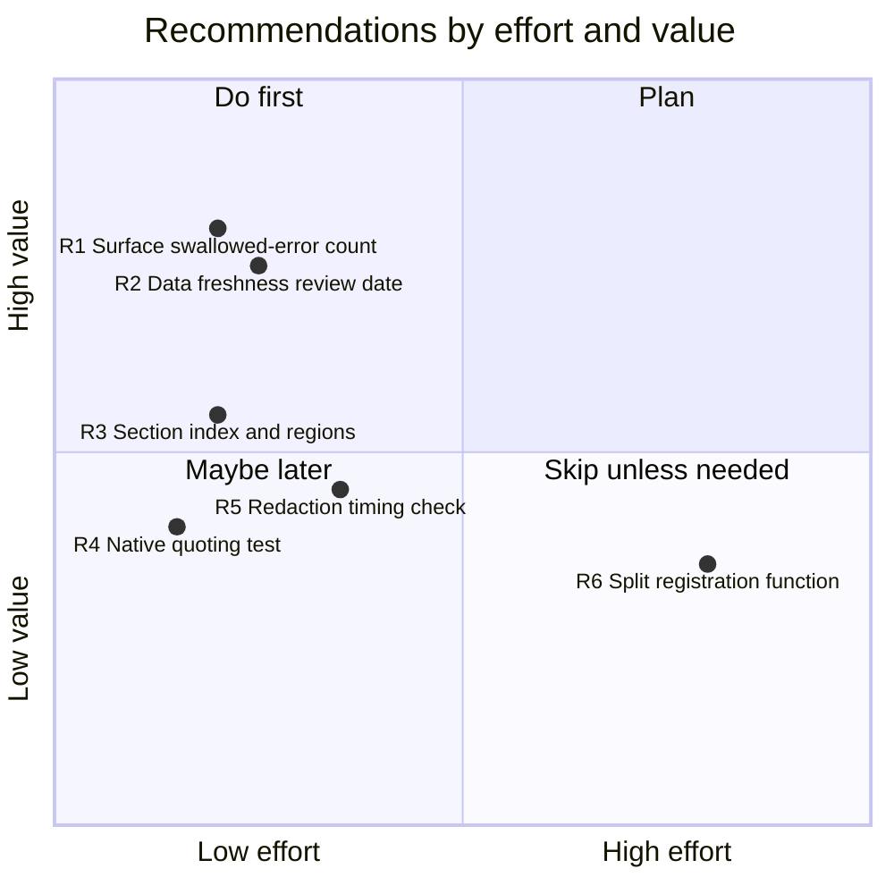

| # | Recommendation | Why | Effort |
|---|---|---|---|
| R1 | Count swallowed errors per check and show a `MANUAL` observation in *Collector coverage* when above zero | Extends the "failures stay visible" rule to optional queries (9.3) | Small |
| R2 | Add a `DataReviewed` date next to each hard-coded vendor table and a test that fails (or an issue-opening CI job) when it is older than, say, 6 months | Makes staleness visible (9.2) | Small |
| R3 | Add an index comment and `#region` markers for the 33 checks | Navigation inside the single file (9.1) without changing ADR 0001 | Small |
| R4 | Add a Pester test for `Invoke-NativeCapture` with a path ending in a backslash and a note on the quoting limit | Closes the future trap (9.4) | Small |
| R5 | Time `Protect-ReportText` on the sample report in the smoke job and fail above a generous limit | Turns the performance guess into a fact (9.5) | Small to medium |
| R6 | Only if a future ADR allows it: split `Register-AssessmentCheck` per area while still emitting one file via the build | Biggest maintainability gain, but conflicts with the current ADR | Large |

Not recommended: converting to a module, adding auto-remediation, or loosening the rule that every swallowed
error is logged. Each would work against the properties that make the tool trustworthy.

---

## 12. Limits of this evaluation

- **No execution.** I could not run the script or the Pester suite here, so test results, runtime, and report
  rendering are not verified. Treat the "Pass" results in section 10 as code-reading results.
- **Sampled, not exhaustive.** I read the header, parameters, detection patterns, the core helpers, several
  decision functions, the report/JSON writer, redaction, prerequisites and the main flow. I did not read the
  bodies of most checks (lines 2097 to 3424), the HTML builder, or the merge script.
- **Counts.** Line counts come from the section banners at the time of review. Counts of `SilentlyContinue`
  (37) and `Write-Swallowed` (48) are from `grep` and include the definitions and comments.
- **Vendor facts** (end-of-support dates, supported paths, SQL and VMware minimums) were **not** re-verified
  against Microsoft or VMware in this review.
- **Point in time.** Version 4.3.0 plus unreleased changes on `main` as of 2026-10-22.
