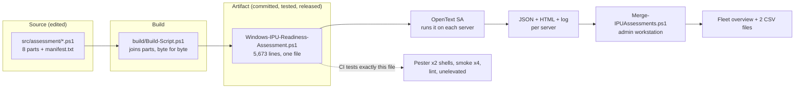
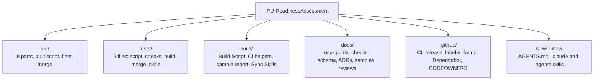
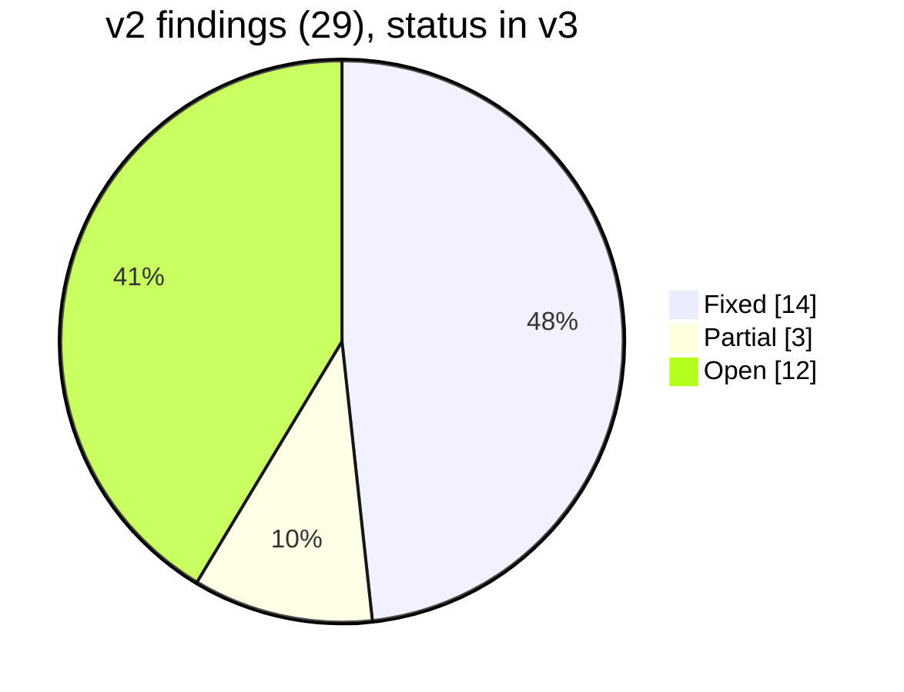
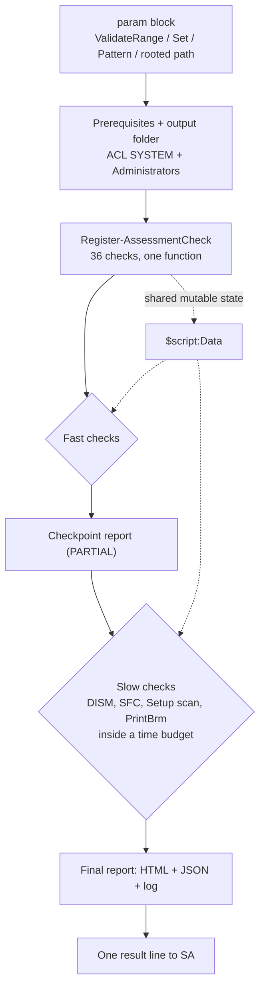
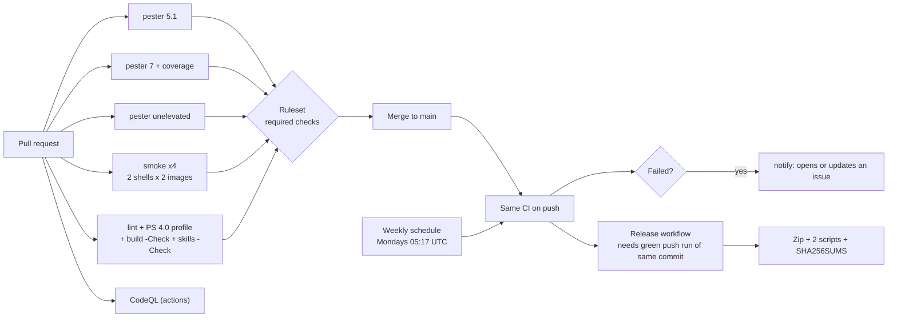
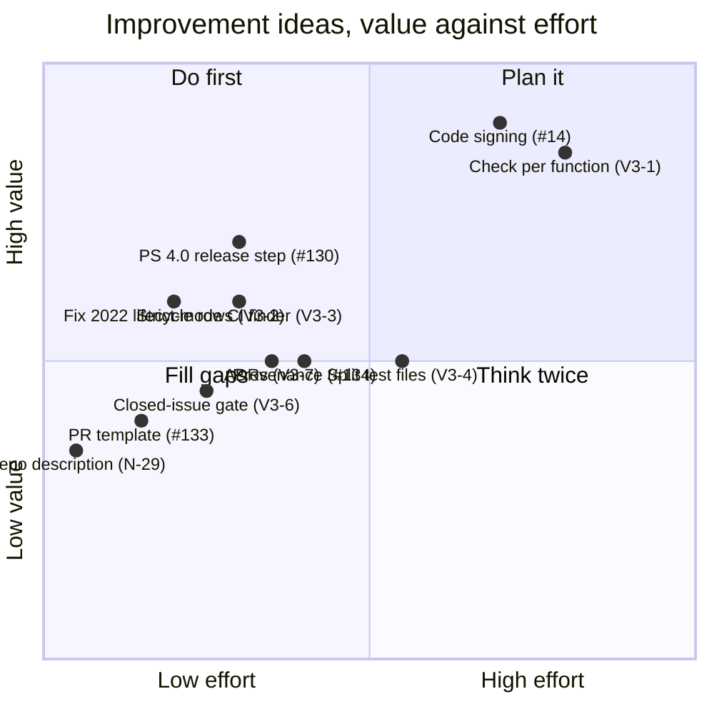
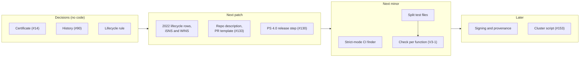
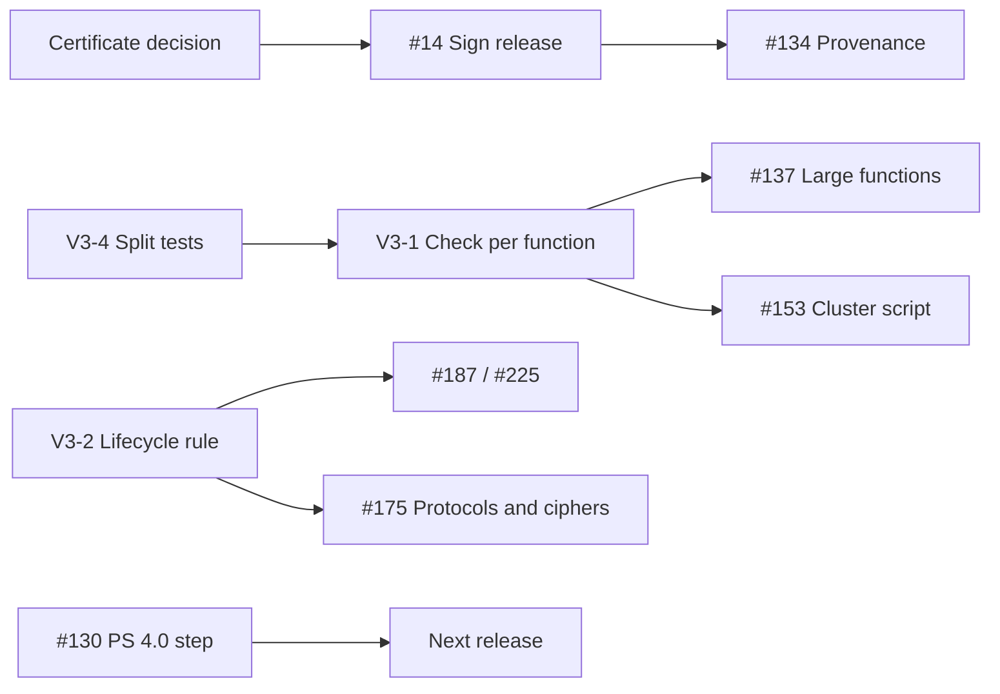

# Repository Audit Review v3: IPU-ReadinessAssessment

| | |
|---|---|
| **Reviewed** | 2026-10-22 |
| **Code state** | `main` at `4f4b496` (merge of PR #222, release 4.5.3), 266 commits |
| **Scope** | Whole repository: both scripts, the eight source parts, five test files, build scripts, three workflows, ruleset and settings, docs, governance and AI-assistant files, issues and releases |
| **Method** | Own investigation first (read of README, CONTRIBUTING, SECURITY, build docs, checks reference, ADRs, workflows, build scripts and the main code paths; greps and counts on the tree; GitHub API and `gh` for settings, rulesets, issues, releases and runs; a full Pester run with coverage). The v1 and v2 reviews were read **afterwards**, only to reconcile their findings in section 3 |
| **Author** | Claude (Sonnet 5.5) |
| **Relation to v1, v2** | Independent re-evaluation. v1 (2026-10-06) and v2 (2026-10-08) are not edited by this document |

Evidence labels: **CONFIRMED** = verified by running something or reading live state (API, CI, file). **PLAUSIBLE** = from reading code, not exercised.

> **Security note.** In line with `SECURITY.md` and the AGENTS.md hard rule, anything exploitable is handled privately with the maintainers and is not part of this public document. This review found nothing of that kind.

---

## Contents

1. [What the repository is today](#1-what-the-repository-is-today)
2. [Verdict](#2-verdict)
3. [v1 and v2 findings reconciled](#3-v1-and-v2-findings-reconciled)
4. [New findings](#4-new-findings)
5. [Detailed review by area](#5-detailed-review-by-area)
6. [Improvement catalogue](#6-improvement-catalogue)
7. [Roadmap](#7-roadmap)
8. [Decisions needed from the maintainers](#8-decisions-needed-from-the-maintainers)
9. [Deliberately not recommended](#9-deliberately-not-recommended)

---

## 1. What the repository is today

A **read-only Windows Server in-place upgrade (IPU) readiness assessment**. An operator runs one PowerShell file on a server (through OpenText Server Automation, SA) before an upgrade to Windows Server 2025 or 2022, and gets one verdict, a prioritised list of what to fix and a self-contained HTML/JSON report. Run again afterwards (`-AssessmentMode Post`), it compares the server with its own pre-upgrade snapshot. A second script merges many JSON results into a fleet overview.

**Intent, in one line:** let a change team find out *before* the maintenance window what an upgrade will break, without the tool itself changing anything.

### Growth since v2 (two weeks)

| Measure | At v2 (2026-10-08) | Now | Source |
|---|---|---|---|
| Version | 4.3.0 | **4.5.3** (six releases: 4.4.0, 4.5.0 to 4.5.3) | tags, GitHub releases |
| Commits on `main` | 154 | **266** | `git log` |
| Built script | 4,243 lines, one hand-written file | **5,673 lines**, built from 8 parts (`src/assessment/`) | `wc -l`, ADR 0002 |
| Checks | 33 (v1 count) | **36** | `docs/checks.md` (36 rows) |
| Pester tests | 594 | **799 pass, 0 fail** | full run, 2026-10-22 |
| Command coverage | 90 % reported, no floor | **91.3 %**, floor 85 %, 0 of 154 functions unexecuted | `Invoke-CiTests.ps1 -Coverage` |
| Issues | n/a | 102 closed, 17 open (incl. this review's #226) | `gh` |
| Pull requests | n/a | 107 | `gh` |

New functionality since v2: evidence folders, redaction key file, a hexadecimal GPO-List fix and registry fallback, certificate-subject redaction, print-server backup, SPECIAL-server facts (domain controllers, clusters), per-adapter network comparison after the upgrade, licensing per channel, dated-fact tracking (`FactSources`), and the build-from-parts step.

### How it runs



### Repository map



---

## 2. Verdict

**Strong for its size and age, and much stronger than at v2.** Every one of the six P1 findings in v2 (a red `main` that became a release, an ungated release, missing protections, a wrong `SECURITY.md`) is fixed with evidence. The repository now has a ruleset on `main`, secret scanning with push protection, private vulnerability reporting, a CI matrix that covers both Windows PowerShell 5.1 and 7 on both Windows Server images, a pinned toolchain, a coverage floor, a weekly run that opens an issue when it fails, and a release workflow that refuses a commit without a green CI run. This is above what most single-script repositories reach.

What is left is **no longer about safety of the process; it is about the code's shape and about the last unsigned step**:

- The script is 5,673 lines and **one function (`Register-AssessmentCheck`) holds 1,580 of them**: all 36 checks, sharing one mutable `$script:Data` bag. The split into parts (ADR 0002) made the *files* smaller; it did not make the *units* smaller.
- Operators still cannot verify *who built* a release (no signature, #14; no build provenance, #134), only that the hash matches.
- Some "dated facts" tables cover a fraction of what Microsoft lists, and one table entry is not supported by the page it cites.
- A handful of P3 items from v2 are still open and cheap.

### Scorecard

Scores are the reviewer's judgement (1 = absent, 5 = exemplary), with v2's score for comparison.

| Area | v2 | v3 | Why |
|---|:-:|:-:|---|
| Safety (non-remediating) | 5 | **5** | Hard rule held; DISM/SFC/LGPO limited; no `Invoke-Expression`, no `Win32_Product`, no `Write-Host` |
| Correctness and failure visibility | 4 | **4** | Crashed check is `MANUAL`; 0 empty `catch`; large shared-state function and no strict mode keep this at 4 |
| Tests | 4 | **5** | 799 pass, 91.3 % coverage, floor enforced, unelevated CI job, build tests |
| CI/CD | 3 | **5** | Both shells, both images, lint with PS 4.0 profile, notify, weekly run, release gate |
| Release and supply chain | 3 | **4** | SHA-pinned actions, pinned tools, hashes, gate on green CI; no signature or provenance |
| Security posture of the repo | 2 | **5** | Ruleset, secret scanning, push protection, PVR on, no open alerts |
| Documentation | 4 | **4** | Thorough, links resolve; user guide is one 839-line file; repo description vague |
| Architecture | 3 | **3** | Parts + build is a good decision; the 1,580-line function and shared `$script:Data` remain |
| Governance and hygiene | 3 | **4** | Issue-first flow works; a few closure gaps (fixed during this review, see N-13) |
| Report and operator experience | 4 | **4** | Self-contained, dark mode, accessible markup |

```text
Scorecard v3 (v2 in brackets)

Tests               [####-] -> [#####]
CI/CD               [###--] -> [#####]
Release             [###--] -> [####-]
Repo security       [##---] -> [#####]
Documentation       [####-] -> [####-]
Architecture        [###--] -> [###--]   <- the one area that did not move
Governance          [###--] -> [####-]
```

### Confirmed facts

| Fact | Evidence |
|---|---|
| `main` is green and protected | CI push run on `4f4b496` success; ruleset has `deletion`, `non_fast_forward`, `pull_request`, `required_status_checks` |
| Latest release matches `main` | `v4.5.3` = `4f4b496`; downloaded assets pass `sha256sum -c SHA256SUMS.txt`; released script is byte-identical to `src/` on `main` |
| No open code-scanning or Dependabot alerts | API: 0 and 0 |
| Secret scanning, push protection, Dependabot security updates, private vulnerability reporting: all on | `security_and_analysis`, `private-vulnerability-reporting` |
| No `Invoke-Expression`, no `Write-Host`, no empty `catch {}` | grep over the script and merge script |
| 154 functions, none unexecuted by the tests | coverage run |
| Docs have no broken relative links | link check over `README.md`, `CONTRIBUTING.md`, `docs/*.md` (file part only, not anchors) |
| Repository description is "A full IPU Readiness Assessment Suite", no homepage | `gh repo view` |

---

## 3. v1 and v2 findings reconciled

### v1 (29 items, including 4 gaps)

| Status | v2 said | v3 says | What changed |
|---|:-:|:-:|---|
| Fixed | 21 | **23** | P2-6 (coverage floor 85 % enforced); section 5 public-release gate (repo public with the controls in place) |
| Partial | 3 | **2** | P2-7 (site-flavoured defaults), section 4.1 truncated DISM output (not re-tested here) |
| Open | 2 | **1** | P1-5 code signing (#14) |
| Superseded | 3 | **3** | P2-3, P3-2, section 4.2 per-vendor fixtures |

### v2 (29 findings, N-1 to N-29)



| v2 ID | Finding | Status | Evidence today |
|---|---|---|---|
| N-1 | `main` red: redaction leak on Windows Server 2022 | **Fixed** | Smoke green on both images; CI push run on `4f4b496` success |
| N-2 | Release not gated on CI | **Fixed** | `release.yml` waits for the push run of the commit and refuses anything but success (#121) |
| N-3 | PRs skipped the windows-2022 smoke jobs | **Fixed** | `ci.yml` smoke matrix: both images on every event (#122) |
| N-4 | Failed push to `main` notified nobody | **Fixed** | `notify` job covers push and schedule (#123) |
| N-5 | Public repository, protections off | **Fixed** | Ruleset (4 rules), secret scanning, push protection, PVR, Dependabot updates |
| N-6 | `SECURITY.md` wrong | **Fixed** | Rewritten: private reporting via the Security tab, supported versions, scope |
| N-7 | No negative fixture suite for redaction | **Partial** | 9 redaction `Describe` blocks in the main test file and 1 in the merge tests; independence from the smoke test not audited |
| N-8 | ADR 0001 revisit trigger fired | **Fixed** | ADR 0002 accepted; ADR 0001 marked superseded |
| N-9 | Tests not portable to an unelevated workstation | **Fixed** | CI job `pester (unelevated)`; README states both modes (#126) |
| N-10 | Stale facts in docs | **Fixed** | `repository is private`, `not available on this plan`, test counts gone. One historical "about 2,700 lines" remains inside the superseded ADR 0001, which is acceptable for a dated record |
| N-11 | No coverage floor | **Fixed** | Floor 85 % and "no unexecuted function" gate; measured 91.3 % (#127) |
| N-12 | Fleet merge output not restricted | **Fixed** | `Merge-IPUAssessments.ps1` sets an ACL on its output folder (`New-MergeFolderSecurity`, code read) |
| N-13 | Issue hygiene lapses | **Partial** | During this review: #221 closed with four unchecked criteria (now evidenced and ticked), #147 and milestone 4.3.1 obsolete (closed), #90 and #14 had no milestone (now `Future`). #90's owner decision is still open |
| N-14 | Skills vendored twice, one commit bypassed the flow | **Fixed** | `Sync-Skills.ps1 -Check` in lint (#129); the stray local commit was identical to remote content and is dropped |
| N-15 | PowerShell 4.0 only checked statically | **Open** | #130 |
| N-16 | Site-flavoured defaults | **Partial** | `NumberCultureName = 'da-DK'` remains (`10-parameters.ps1:97`); "Company policy" wording no longer found |
| N-17 | Dated facts go stale silently | **Fixed** | `$script:FactSources` with `Verified` dates; a test fails after six months; weekly CI opens an issue |
| N-18 | PR template thin | **Open** | 10 lines, 2 checkboxes (#133) |
| N-19 | Labeler gaps | **Open** | Tracked in #133; not re-audited line by line |
| N-20 | No build provenance | **Open** | #134 |
| N-21 | Release zip omits the sample | **Open** | #135 |
| N-22 | No code of conduct | **Fixed** | `CODE_OF_CONDUCT.md` present (128 lines). Issue-form contact links are part of #133 |
| N-23 | Native argument quoting | **Open** | #136; `Invoke-NativeCapture` quotes on whitespace only (code read) |
| N-24 | Very large functions | **Open, worse than reported** | See V3-1: the real outlier is `Register-AssessmentCheck` (#137) |
| N-25 | Merge counts redacted copy twice | **Open** | #138 |
| N-26 | `NumberCultureName` unvalidated | **Open** | #139 |
| N-27 | Create-then-restrict window | **Open** | #139 |
| N-28 | No one-command local workflow | **Open** | #140 |
| N-29 | Vague repository description | **Open** | Confirmed live; one `gh repo edit` |

All 12 open v2 items are P3 or P2 and already have an issue, except N-29 (a setting, no issue needed).

---

## 4. New findings

Priority model as in the repo's skills: **P0** broken/unsafe, **P1** important quality, reliability or security, **P2** valuable improvement, **P3** polish. **Nothing is P0 or new P1.** The two inherited P1 items are #14 (signing) and #90 (history clean-up decision).

### P2: valuable

| # | Finding | Evidence | Why it matters | Fix |
|---|---|---|---|---|
| V3-1 | **One function holds 36 checks and 1,580 lines.** `Register-AssessmentCheck` (3143 to 4723 in the built file) is a flat list of `Register-Check -Id ... -Script { ... }` blocks that all read and write one `$script:Data` bag. Next largest: `New-IPUReportHtml` 234, `Invoke-RdpPolicyAssessment` 176, `Protect-ReportText` 141 | CONFIRMED (line counts) | The 8-part split reduced file size, not unit size. Order coupling through `$script:Data` is invisible: a check that reads `$script:Data.Features` silently depends on `baseline` having run. #153 (cluster script) would inherit this | Move each check into its own function in its own part (`50-checks-storage.ps1` and so on), taking its inputs from `$script:Data` through named accessors. Do it as behaviour-preserving PRs with the build `-Check` and tests green before and after (the ADR 0002 approach). Extend #137, which names only two functions |
| V3-2 | **Dated-fact table is thin and has one unsupported row.** `$script:FeatureLifecycle` has 7 entries. Microsoft's page lists 12 deprecated and 7 removed features for Windows Server 2025 (for example Computer Browser, Cluster Sets, Remote Mailslots, WMIC, VBScript, RC4 in Kerberos, Internet Explorer, WordPad). On the 2022 tab it lists iSNS as removed and WINS, WDS boot.wim, Shielded VMs and LBFO-on-vSwitch as no longer developed. The table marks NLB, WebDAV Redirector and WID as deprecated for **2022**, but they appear on the **2025** tab only | CONFIRMED (page read 2026-10-22; table read `20-detection-patterns.ps1:64`). Impact on a 2022 target is a WARNING observation, not a blocker | A report that lists a deprecation the cited page does not support, or omits a removed feature (iSNS), erodes trust in the rest. The omission is silent | (1) Decide the rule: *only what the page lists for the target.* (2) Fix the three 2022 rows. (3) Add iSNS (`ISNS`), WINS (`WINS`) for 2022. (4) Test that every row names the tab it comes from. Related to #187 and #225 |
| V3-3 | **No `Set-StrictMode`.** A misspelled variable is `$null`, and a check that reads a missing property gets `$null` instead of an error | CONFIRMED (no occurrence in `src/`, `tests/`, `build/`). The 49 lines with `SilentlyContinue` add to this | "Failures stay visible" is a hard rule; `$null` from a typo is a failure that is not visible. In a 5,673-line script that grew by 1,400 lines in two weeks the risk is real, though no instance was found | Do not switch it on in production (too risky for a read-only tool that must finish). Run the Pester suite under `Set-StrictMode -Version 2` in one CI job to find real defects, then decide per finding |
| V3-4 | **Tests are two very large files.** `Windows-IPU-Readiness-Assessment.Tests.ps1` is 3,317 lines (80 `Describe` blocks) and `Checks.Tests.ps1` 1,844 lines | CONFIRMED | Same reviewability problem the source had. Merge conflicts concentrate in these files when two people add checks | Mirror the source split: `tests/decision-rules/`, `tests/checks/`, `tests/report/`, `tests/redaction/`. `docs/checks.md` already requires a test per check, so the mapping exists |

### P3: polish

| # | Finding | Evidence | Fix |
|---|---|---|---|
| V3-5 | **Pinned tools have no update path.** Dependabot covers `github-actions` only. Pester 5.7.1 and PSScriptAnalyzer 1.23.0 are pinned in `ci.yml` by hand | CONFIRMED (`dependabot.yml`, `ci.yml` env) | A monthly scheduled job that compares the pins with the Gallery and opens one issue. Keeps the pinning benefit without silent ageing |
| V3-6 | **Closure gate relies on memory.** #221 was closed as completed with four unchecked criteria and nothing noticed for four days | CONFIRMED | A weekly workflow (or an addition to the CI `notify` job) that lists issues closed as completed with unchecked boxes. Cheap, and it is exactly the check this review ran by hand |
| V3-7 | **Only two ADRs for a larger set of real decisions.** Decisions that were argued and settled but have no record: non-remediating contract, redaction as best effort with a key file, result schema versioning (`IPU-Assessment/1`) and how Post handles older baselines, "failures are MANUAL", site-neutral defaults | CONFIRMED (`docs/adr/` has 2) | Short ADRs (half a page each). They stop the same debate in two months and they are what a new maintainer reads first |
| V3-8 | **User guide is one 839-line file.** Link check passes, but one file makes search and review heavy | CONFIRMED | Split by reader: *run it* (operator), *read the result* (change team), *fleet* (admin), *test and contribute* (developer). Keep the current file as an index for old links |
| V3-9 | **`ErrorAction SilentlyContinue` count is up.** 49 lines mention it (v2 counted 37 at the time) | CONFIRMED (grep); not every one is wrong | Review them in the V3-1 refactor; each should be a conscious "absence is normal here", not a way to skip an error. Route through `Write-Swallowed` where it is not |
| V3-10 | **Authorship concentration.** `git shortlog` on `main`: Claude 129, Micker71 87, Jean Kadang 48 commits. Two human maintainers, both in CODEOWNERS, reviews "welcome, not required" | CONFIRMED | Not a defect. It is why the ruleset's required checks and the issue-first flow matter, and why decisions belong in ADRs (V3-7). Consider requiring one review once a third human contributor appears |
| V3-11 | **Licence implications are undocumented.** GPL-3.0 on a script that companies will run through their own automation platform and may modify | PLAUSIBLE | One FAQ paragraph in the README: running it internally is fine; distributing a modified copy carries GPL terms. Avoids the question reaching the maintainers one by one |

### Things that are good (protect these)

- **Failures stay visible.** A check that throws becomes `MANUAL` in *Collector coverage*; the report says that absence of findings is not evidence of readiness.
- **Decision logic is pure and tested.** `Get-*Decision` functions take data in and return a verdict, so facts can be tested without a server.
- **The fake-server test design.** 36 checks run against a simulated server; a test fails when a check has no `docs/checks.md` entry.
- **CI tests the file operators run.** The build step builds first; lint, Pester and smoke all use the built file; `Build-Script.ps1 -Check` fails when it drifts.
- **Release discipline.** Version in header = `CollectorVersion` = CHANGELOG = tag; green CI on the same commit; hashes published; a dry run exists.
- **Dated facts are dated.** `FactSources` plus a six-month test turns "Microsoft changed something" into an issue.
- **Honest documentation.** README states what is not done (unsigned, best-effort redaction, side effects of the Setup scan).
- **Issue-first with real acceptance criteria.** 102 closed issues, most with criteria and evidence.

---

## 5. Detailed review by area

### 5.1 Assessment script



| Aspect | Finding |
|---|---|
| Native tools | One wrapper (`Invoke-NativeCapture`): timeout, raw-byte capture, UTF-16 decode for SFC, process-tree kill on timeout. Quoting handles whitespace but not embedded quotes or a trailing backslash (N-23, low risk as callers pass fixed arguments) |
| Error handling | 0 empty `catch`; `Write-Swallowed` exists; 49 `SilentlyContinue` lines. No strict mode (V3-3) |
| Safety | No `Invoke-Expression`, no `Win32_Product`, DISM `/ScanHealth`, SFC `/verifyonly`, LGPO `/b` and `/parse` only (as the hard rules require) |
| Redaction | `Protect-ReportText` (141 lines) is the core. Best effort by design and documented as such; key file readable by SYSTEM, Administrators and the current user. Certificate subjects now covered (#212) |
| Report HTML | One `ConvertTo-HtmlText` encoder used on collected text; `lang="en"`, `aria-label`, `aria-hidden`, `prefers-color-scheme` present |
| Size | 5,673 lines built; 154 functions; largest unit 1,580 lines (V3-1) |
| Fleet merge | 217 lines, 5 functions; CSV formula guard present (apostrophe prefix, OWASP); output ACL set |

### 5.2 Tests

| Aspect | Finding |
|---|---|
| Volume | 799 pass, 0 fail, 0 skipped on PowerShell 7.6.7; 16 tests tagged Integration start real processes |
| Coverage | 91.3 % of commands in `src/*.ps1`; 0 of 154 functions without an executed command; floor 85 % |
| Modes | Elevated and unelevated (a CI job runs as a temporary standard user) |
| Structure | Two files hold 5,161 of about 5,500 test lines (V3-4) |
| Gap | PowerShell 4.0 behaviour is not run anywhere (N-15 / #130) |
| Gap (idea) | Mutation-style check: flip a threshold in a decision function and confirm a test fails. Coverage says a line ran, not that a test would notice it being wrong |

### 5.3 CI/CD and release



All actions pinned to commit SHAs with a version comment; `permissions: contents: read` at the top, `issues: write` only on `notify`; the only `pull_request_target` workflow (labeler) never checks out PR code. Residual: no retry on the module install (#141), pins without an update path (V3-5), no signature or provenance (#14, #134).

### 5.4 GitHub settings

| Setting | State |
|---|---|
| Visibility / licence | Public, GPL-3.0 |
| Default branch | `main`, ruleset active: PR required, required status checks, no force-push, no deletion |
| `delete_branch_on_merge` | On; no stale branches |
| Secret scanning / push protection / Dependabot security updates / PVR | On |
| Code scanning | CodeQL on Actions, 0 open alerts |
| Wiki / Discussions | Off (ideas are filed as P3 issues by decision) |
| Description / homepage / topics | Description vague (N-29), no homepage, 4 topics |
| Milestones | Closed per release; `Future` open with 14 issues; 4.3.1 closed during this review |

### 5.5 Documentation

| File | Verdict |
|---|---|
| `README.md` | Clear: outputs, flow diagram, quick start, status table, safety, layout. Its `docs/review/` row still said "newest: v2"; updated with this review |
| `CONTRIBUTING.md` | Accurate against the workflows; documents the CI table and the build step |
| `SECURITY.md` | Correct and specific (scope includes CSV injection and redaction leaks) |
| `docs/checks.md` | 36 rows, grouped by chapter, kept in step by a test |
| `docs/user-guide.md` | Complete but long (V3-8) |
| `docs/result-schema.*` | Markdown plus JSON Schema; smoke test validates against it |
| `docs/adr/` | Two records (V3-7) |
| `docs/build.md` | Plain-language; matches `Build-Script.ps1` behaviour |

### 5.6 Operator experience

Strengths: one verdict, worst-first ordering, a sample report with a fictional server, and a fleet overview. Opportunities: the sample report is not in the release zip (#135); there is no short "first run in five minutes" page for someone who only wants to try it on one test server.

---

## 6. Improvement catalogue

Every idea, grouped. Priority in brackets; the ones already tracked name their issue.

### 6.1 Code health and architecture

| Idea | Priority |
|---|---|
| One function per check, one part per chapter (V3-1) | P2 |
| Replace the `$script:Data` bag with a documented list of keys, each owned by one check, plus a test that every key read is written by an earlier check | P2 |
| Split `New-IPUReportHtml` and `Invoke-RdpPolicyAssessment` (#137) | P3 |
| Review each `SilentlyContinue` (V3-9) | P3 |
| Strict-mode CI job as a finder, not a gate (V3-3) | P2 |
| Escape native arguments per `CommandLineToArgvW` (#136) | P3 |
| Validate `NumberCultureName`; create-with-ACL in one call (#139) | P3 |
| Dedicated cluster node script from shared parts (#153, after V3-1) | P3 |

### 6.2 Tests and quality

| Idea | Priority |
|---|---|
| Split the two large test files to mirror the source (V3-4) | P2 |
| PowerShell 4.0 manual smoke step in the release checklist (#130) | P2 |
| Mutation-style sanity test for decision functions | P3 |
| Property-style tests for `Protect-ReportText`: feed random hostnames, IPs, accounts and assert none survive | P3 |
| A golden-file test for the sample report, so a report change shows as a reviewable diff | P3 |
| Truncated DISM text into `Get-DismVerdict` (v1 section 4.1 residual) | P3 |

### 6.3 CI/CD and release

| Idea | Priority |
|---|---|
| Sign the release script, publish the hash in the notes (#14, needs a certificate decision) | P1 |
| Build provenance attestation next to the hashes (#134); free for public repositories | P3 |
| Put `docs/samples/` in the zip (#135) | P3 |
| Retry on module install (#141) | P3 |
| Monthly check of the pinned tool versions (V3-5) | P3 |
| Weekly list of issues closed with unchecked boxes (V3-6) | P3 |
| One-command local run of the CI checks (#140) | P3 |

### 6.4 Security

| Idea | Priority |
|---|---|
| Decide the git-history and edit-revision clean-up for #90, and record it | P1 |
| Signing and provenance (above) | P1 / P3 |
| Keep "best effort" wording on redaction; add a negative-fixture suite independent of the runner image (N-7) | P2 |
| Document the threat model on one page: who runs it, as which account, what the report reveals, what the key file reveals | P3 |

### 6.5 Documentation

| Idea | Priority |
|---|---|
| Set the repository description and homepage (N-29) | P3 |
| Split the user guide by reader (V3-8) | P3 |
| ADRs for the settled decisions (V3-7) | P3 |
| Licence FAQ paragraph (V3-11) | P3 |
| "First run in five minutes" page | P3 |
| Facts page: which Microsoft page backs which table, with the tab (supports V3-2) | P2 |

### 6.6 Facts and correctness

| Idea | Priority |
|---|---|
| Rule "only what the page lists for the target"; fix NLB, WebDAV, WID rows for 2022 (V3-2) | P2 |
| Add iSNS and WINS for 2022 | P2 |
| Expand the 2025 deprecated list (Computer Browser, Cluster Sets, Remote Mailslots, WMIC, VBScript, RC4 in Kerberos) as observations | P3 |
| Protocol, cipher, SMB and NTLM impact (#175) | P2 |
| Effort estimates as ranges (#155) | P2 |

### 6.7 Governance

| Idea | Priority |
|---|---|
| Fill the PR template: lint, CHANGELOG, `docs/checks.md`, sample regenerated, no host data (#133) | P3 |
| Require one review when a third human contributor joins (V3-10) | P3 |
| Give #90 and #14 an owner and a date, not only a milestone | P2 |

### Priority and effort



---

## 7. Roadmap

Priority is importance; milestone is delivery. The repository uses release-number milestones plus `Future`; this roadmap proposes the next three.



### Dependency map



Splitting the tests first (V3-4) makes the check-per-function refactor (V3-1) reviewable, and the refactor must land before the cluster script (#153) to avoid copying the problem.

### Milestones

| Milestone | Contents |
|---|---|
| 4.5.4 (patch) | V3-2 rows and iSNS/WINS, #130 step, #133, #136, #138, #139, README/repo description |
| 4.6.0 | V3-3 strict-mode finder (findings become issues), V3-4 test split, V3-5, V3-6, #140, #141, #135 |
| 4.7.0 | V3-1 check per function, #137, then #153 |
| Future | #14 signing and #134 provenance until the certificate decision, #155, #175 |

---

## 8. Decisions needed from the maintainers

| # | Decision | Why now |
|---|---|---|
| 1 | Is a code-signing certificate available? (#14) | The only open v1 P1; blocks #134's value |
| 2 | Rewrite git history and delete old edit revisions, or accept? (#90) | P1 open since 2026-10-07; the ruleset blocks force-push, so a rewrite means lifting it for a moment |
| 3 | Lifecycle rule: *only what Microsoft lists for the target*, or a broader "also relevant" list? | Decides V3-2 and keeps #175 consistent |
| 4 | Is the check-per-function refactor worth a minor release of its own? | V3-1 is the largest remaining quality item, with no user-visible change |
| 5 | Require a review before merge? | Today welcome, not required; fine for two maintainers, revisit at three |
| 6 | Keep `da-DK` as the default `NumberCultureName`? | Last visible site-specific default (N-16) |

---

## 9. Deliberately not recommended

- **Splitting into PowerShell modules.** Operators run one file through SA; ADR 0002 keeps that and gets the maintainability through parts and a build.
- **A Projects board.** Two maintainers; milestones, labels and issue-first work. A board would be another thing to keep in step.
- **`Set-StrictMode` in production.** For a tool that must finish and report, a thrown error from strict mode is worse than a `$null`. Use it as a test-time finder (V3-3).
- **Raising the coverage floor now.** 91.3 % against a floor of 85 % is the right gap; a higher floor adds friction before V3-4 makes tests easier to add.
- **Requiring reviews today.** With two human maintainers and a required-checks ruleset, the control is the checks.
- **Rewriting the sample report by hand.** It is generated by `build/New-SampleReport.ps1`; keep it generated.
- **Automating a PowerShell 4.0 runner.** A self-hosted runner on a public repository is not advisable (#130); a manual step with recorded evidence is enough.

---

*Written for issue #226. v1 (`audit-review-Claude.md`) and v2 (`audit-review-claude-v2.md`) are kept as they were.*
