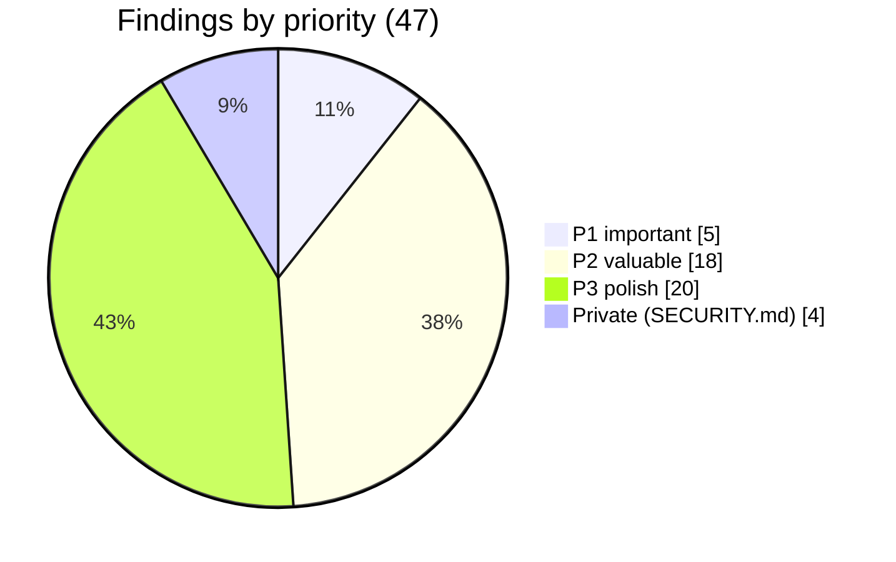
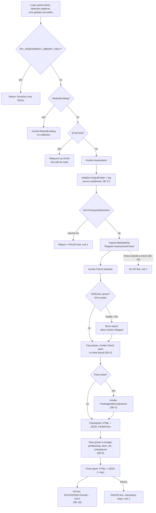
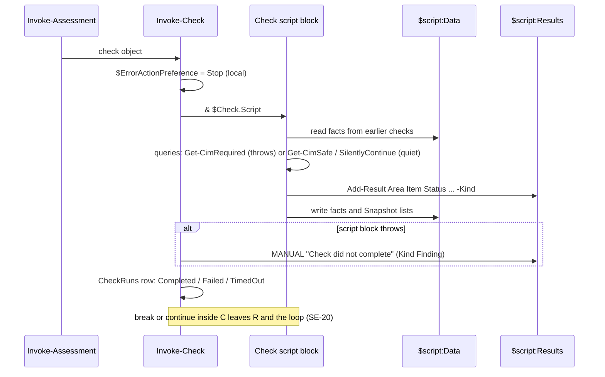
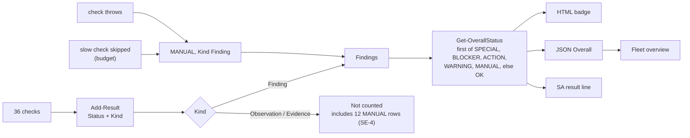
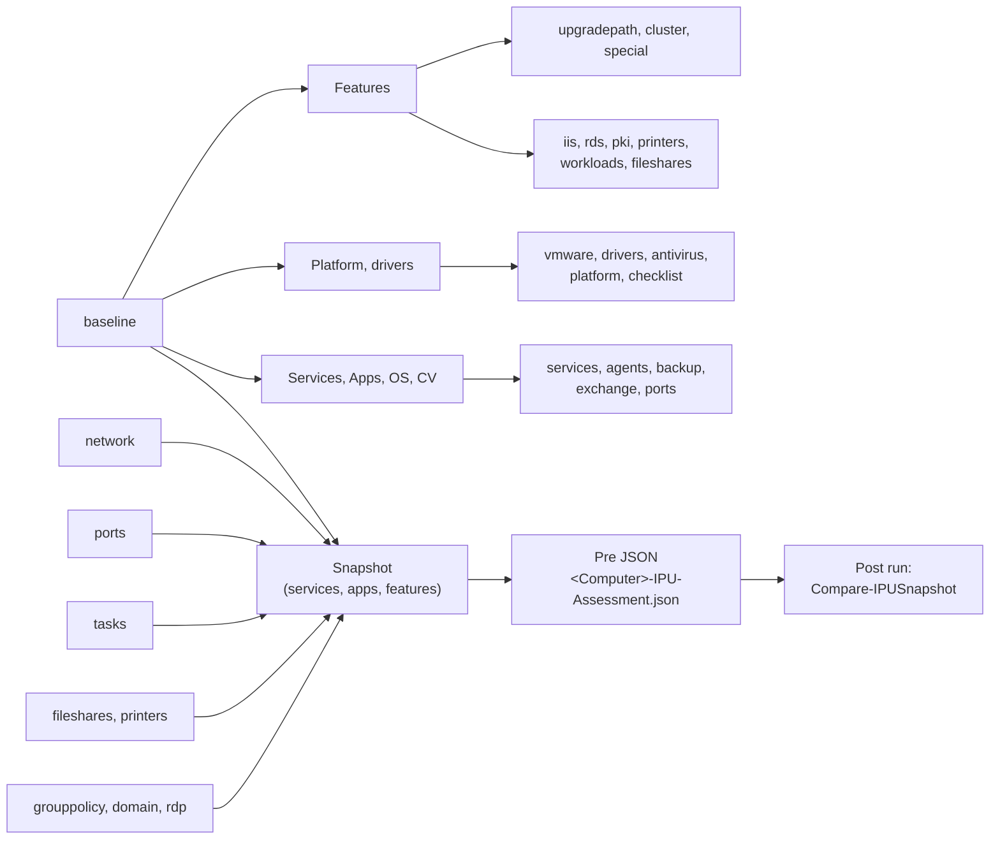
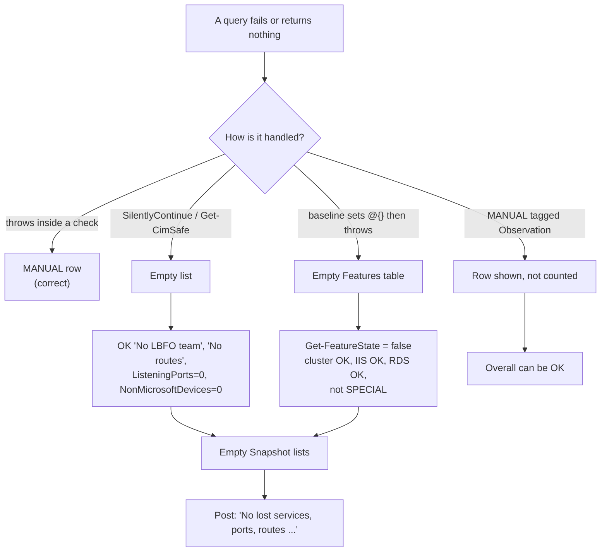
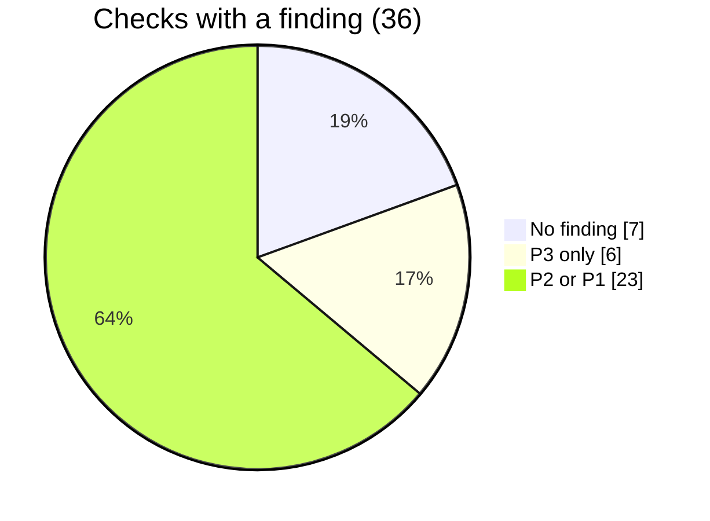
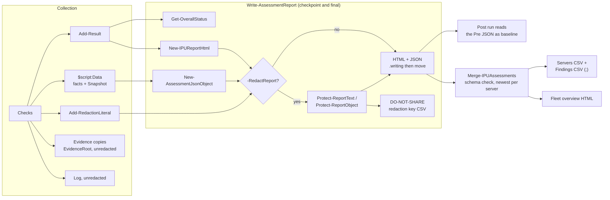
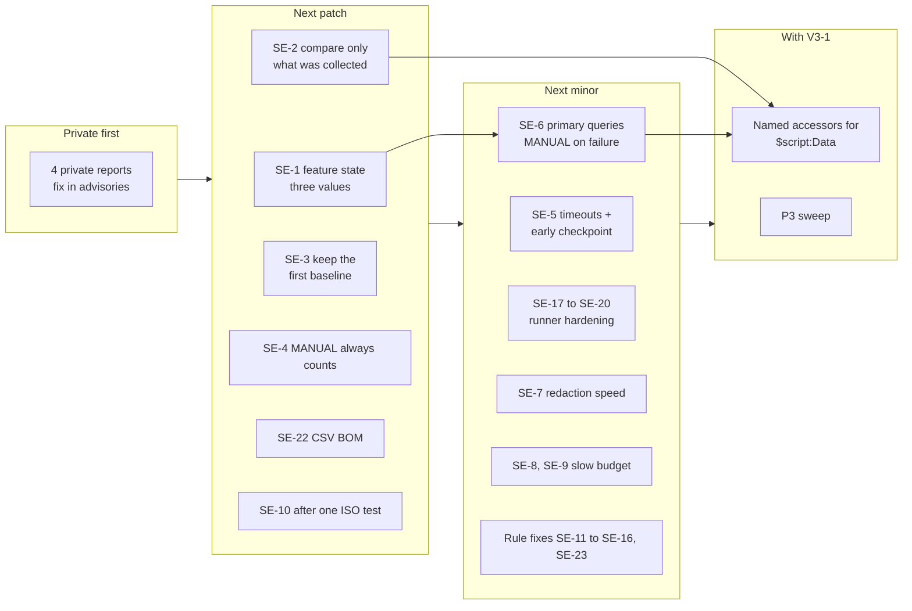
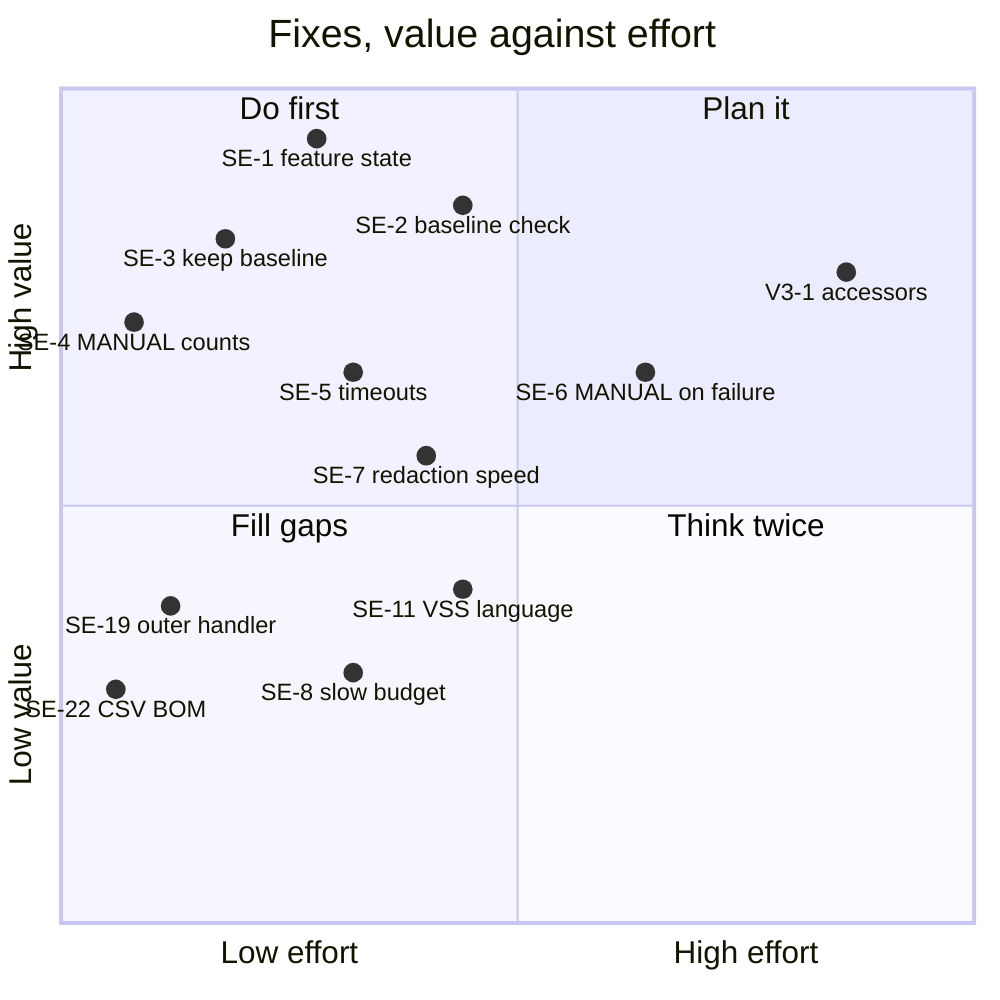

# Script Evaluation 4.5.3: Windows-IPU-Readiness-Assessment

| | |
|---|---|
| **Evaluated** | 2026-10-22 |
| **Code state** | `main` at `1f32208`: release 4.5.3 plus the `FactSources` note fix from #225 (no behaviour change) |
| **Scope** | The assessment script through its parts in `src/assessment/` (00-header to 70-main), and `src/Merge-IPUAssessments.ps1`. Not the repository process, CI or governance: [review v3](audit-review-claude-v3.md) covers those |
| **Method** | Five area reviews in parallel (runtime, decision rules, checks part 1, checks part 2, report/redaction/merge), each reading its parts in full and running edge cases against the built script in library mode (PowerShell 7 on Linux, `IPU_ASSESSMENT_LIBRARY_ONLY=1`). Every P1 and most P2 findings were then re-checked against the code by a second reader |
| **Author** | Claude (Opus 5.5) |
| **Issue** | #228 |

Evidence labels: **CONFIRMED** = reproduced by running the function, or the code path is unambiguous. **PLAUSIBLE** = from reading code; depends on Windows behaviour that could not be run here (no Windows host in the review environment).

Line references are `part:line`, for example `50:498` = `src/assessment/50-checks.ps1` line 498, `M:195` = `src/Merge-IPUAssessments.ps1` line 195.

> **Security note.** Four findings fall within the scope of [`SECURITY.md`](../../SECURITY.md) (redaction, handling of collected data, the fleet merge script). They go to the maintainers through private vulnerability reporting and are **not described in this document**. They are counted in the overview only.

---

## Contents

1. [Verdict](#1-verdict)
2. [How the script works](#2-how-the-script-works)
3. [The main theme: unknown becomes clean](#3-the-main-theme-unknown-becomes-clean)
4. [Findings](#4-findings)
5. [Check by check](#5-check-by-check)
6. [Decision rules and tests](#6-decision-rules-and-tests)
7. [Report, JSON and fleet overview](#7-report-json-and-fleet-overview)
8. [Strengths to protect](#8-strengths-to-protect)
9. [Recommended order](#9-recommended-order)

---

## 1. Verdict

**The script is careful, read-only and well tested, and it keeps its main promises at the level of a whole check.** A check that throws is reported as `MANUAL`; native tools cannot hang the run; decision logic is pure and tested; the upgrade-path, edition and lifecycle rules match Microsoft; nothing in the code needs more than PowerShell 4.0.

**The weak spot is one level below that.** The hard rule *"a check that errors must report MANUAL, never a clean result"* is enforced when a whole check fails, but not when:

- a **query inside a check** fails quietly (`-ErrorAction SilentlyContinue`, `Get-CimSafe`) and the check reports `OK` or `0`;
- a **failed baseline** leaves shared data half-filled, and later checks read "empty" as "not installed";
- a `MANUAL` row is tagged **Observation or Evidence**, which the overall status ignores;
- the **post-upgrade comparison** runs against a baseline that is empty, partial or a short SPECIAL report.

None of these was seen in a real report during this review, but each was reproduced in code. They share one fix pattern (section 3).

### Findings overview

| Area | P1 | P2 | P3 | Private |
|---|:-:|:-:|:-:|:-:|
| Runtime and orchestration (00, 10, 30, 70) | 2 | 5 | 3 | 1 |
| Checks (50) | 1 | 6 | 10 | 1 |
| Decision rules (40) | 1 | 5 | 5 | 0 |
| Report, post-upgrade comparison, redaction, fleet (60, merge) | 1 | 2 | 2 | 2 |
| **Total** | **5** | **18** | **20** | **4** |

Two P1 items sit on the post-upgrade baseline (SE-2, SE-3). Since `AssessmentMode` defaults to `Pre` and SA jobs usually run without arguments, they are the most likely to bite in practice.

### Scorecard

| Area | Score (1 to 5) | Why |
|---|:-:|---|
| Safety (non-remediating) | **5** | Only read-only tool modes; Setup runs `scanonly` with dynamic update off; ISO always dismounted in `finally`; the gpresult temp file is removed |
| PowerShell 4.0 compatibility | **5** | No `::new()`, classes, `-AsHashtable`, `Get-LocalUser`; optional modules guarded with `Test-CommandAvailable` |
| Native tool handling | **5** | One wrapper with timeout, raw-byte capture, UTF-16 detection, process-tree kill |
| Failure visibility, whole check | **5** | Every throw becomes a `MANUAL` "Check did not complete" row |
| Failure visibility, inside a check | **2** | Section 3 |
| Decision rules | **4** | Correct core facts; a handful of thresholds and patterns are off (section 6) |
| Language independence | **4** | XML, SIDs, build numbers and `/English` where possible; `vssadmin`, `reagentc` and task accounts are still parsed as English text |
| Time and size behaviour | **3** | Slow phase is budgeted; fast phase has no bound; redaction cost grows quickly |
| Post-upgrade comparison | **3** | Good per-adapter logic; trusts any baseline it finds |
| Report and fleet output | **4** | Self-contained, encoded, atomic writes; see section 7 |

---

## 2. How the script works

### Run flow

### How one check runs

### How the overall status is made

Note the order: `WARNING` outranks `MANUAL`. A server with one warning and one failed check reports `WARNING`. That is a reasonable choice for a readiness view, but it should be stated in the user guide, because readers tend to assume "unknown" is the more serious state.

### Shared data between checks

All checks read and write one hashtable, `$script:Data`. The baseline check fills most of it; the rest is filled by the check that owns each topic. The Pre run stores `Snapshot` in the JSON, and the Post run compares against it.

The arrows are invisible in the code: nothing records that `iis` depends on `baseline` having filled `Features`. Review v3 (V3-1) proposes named accessors; SE-1 is the concrete failure that motivates it.

---

## 3. The main theme: unknown becomes clean

Five of the P1 and P2 findings are the same mistake in different places: **"could not find out" is turned into "found nothing"**.

**A single design rule closes most of it:** *unknown is a value.*

1. Helpers return three states. `Get-FeatureState` already returns `$null` when there is no feature table; it must also do so when the table is incomplete (SE-1). Callers turn `$null` into `MANUAL`.
2. Primary data (the thing a check is about) is read with `Get-CimRequired` or `-ErrorAction Stop` plus a `catch` that adds `MANUAL`. `SilentlyContinue` and `Get-CimSafe` are for enrichment only. A small Pester or AST test can enforce that every `SilentlyContinue` on a `Get-Net*`, `Get-Cim*` or `Get-*Feature` call has a `MANUAL` path, which also addresses V3-9.
3. A `MANUAL` result is always a Finding, whatever else the row is (SE-4).
4. The post-upgrade comparison compares only what the baseline actually collected, and says which lists it could not compare (SE-2).

---

## 4. Findings

Priority model as in the repository: **P0** broken or unsafe, **P1** important, **P2** valuable, **P3** polish. **No P0.** Items already tracked are linked instead of repeated: V3-1 (one 1,580-line function), V3-3 (no strict mode), V3-9 (`SilentlyContinue` count), #136, #137, #138, #139, #130, #175.

### P1: important

| # | Finding | Where | Evidence | Failure scenario | Fix |
|---|---|---|---|---|---|
| SE-1 | **A failed feature inventory reads as "not installed".** The baseline sets `Features = @{}` and then calls `Get-WindowsFeature -ErrorAction Stop`. If that throws, the table stays empty (not `$null`), so `Get-FeatureState` returns `$false` for every role. The rest of the baseline (drivers, `Platform`, `Snapshot`) never runs | `50:17-18`, `30:900-905`, `50:498`, `40:1686-1690`, `30:964` | CONFIRMED (run: table not null, count 0; `Get-SpecialServerDecision 3 $false $true $true` returns empty) | A 2012 R2 cluster node with a broken ServerManager provider gets `cluster OK 'Feature not installed'`, is not marked SPECIAL, and gets the full standard IPU report and plan. IIS and RDS report `OK 'Not installed'`; `platform` falls through to Physical on a VM; `network` crashes on the missing `Snapshot`. The only signal is one `MANUAL` row for the baseline | Fill a local table and assign it after the loop; set `$null` on failure. Wrap features and drivers in their own `try` so `Platform` and `Snapshot` are always set. Decide SPECIAL from the cluster service and `HKLM:\Cluster` when the feature state is unknown, and return `Undecided` (MANUAL) when the baseline did not complete |
| SE-2 | **The post-upgrade comparison is "OK" against an empty, partial or short baseline.** `Compare-IPUSnapshot` only looks for items lost from the baseline, so an empty list compares clean. Nothing reads the baseline's `CheckRuns`, `Partial` or `Special` | `60:623-644`, `40:731`, `40:795-831`, `40:1696`, `70:43` | CONFIRMED (`Compare-IPUSnapshot` with an empty baseline returns 0 differences; line 644 then writes `Comparison OK`) | (a) The Pre baseline check failed, so `Snapshot` is `{}`. (b) A cluster or DC Pre run kept only 9 checks, so ports, routes, adapters, tasks, shares and printers were never collected; the Post run does not apply SPECIAL and collects everything. (c) The Pre `ports` check silently got nothing (SE-6). In all three the Post report says "No lost services, ports, routes, IP/DNS settings ..." | Read the baseline's `CheckRuns` and `Special`. For each snapshot list, if its source check did not complete or the property is missing, add `MANUAL '<list> not compared'`. Validate `Schema`, `ComputerName` and `Mode`. Write `Comparison OK` only when every list was compared |
| SE-3 | **Running Pre again overwrites the baseline.** In Pre mode the report JSON and the baseline are the same file, and the checkpoint and the final write both replace it | `30:36-37`, `70:58`, `60:555` | CONFIRMED (code path) | The SA job is re-run without `-AssessmentMode Post` after the upgrade (the default is Pre). The baseline now describes the upgraded server; a later Post run compares post with post and reports `OK`. A Pre re-run that SA kills after the checkpoint also replaces a complete baseline with a partial one | Before overwriting a complete baseline, keep it as `<Computer>-IPU-Assessment-<timestamp>.json` when the new run is partial or the source release differs. In Post, add `MANUAL 'baseline was taken after the upgrade'` when the baseline's release already equals the target |
| SE-4 | **`MANUAL` rows tagged Observation or Evidence do not count.** `Get-OverallStatus` keeps only `Kind -eq 'Finding'`. Twelve `MANUAL` rows in the checks are tagged Observation or Evidence | `40:1748-1755`; for example `50:806`, `50:1213` | CONFIRMED (run: Observation MANUAL + Evidence MANUAL + Finding OK gives `OK`; 12 rows counted by grep) | `Get-WindowsFeature` unavailable: `ROLES Inventory` is MANUAL/Observation, the removed-feature and role checks are skipped, and the overall status can still be `OK`, also in the fleet overview. Same for "VSS writer state could not be read" | Count `MANUAL` (and anything worse) regardless of Kind, or reject that combination in `Add-Result`. At least make the "could not read" rows Findings. Add a test that no `MANUAL` row is excluded from the overall status |
| SE-5 | **The fast phase has no time bound.** `Get-CimRequired` (23 calls) has no `-OperationTimeoutSec`; the WMI-filter LDAP lookups have no `ClientTimeout` (the other searchers set 30 s); `GetComputerDomain()` has none. The checkpoint is written only after all fast checks | `30:754-762`, `30:444-458`, `30:1000`, `70:55-58` | PLAUSIBLE (needs a hung provider or unreachable DC to show) | A hung WMI provider or an unreachable DC (both common on servers that are due an upgrade) stalls one fast check until SA's job timeout. SA then has no report and no result line, only the log | `-OperationTimeoutSec 120` in `Get-CimRequired`; `ClientTimeout` and `ServerTimeLimit` on every searcher; write a minimal checkpoint after the baseline, or give the fast phase its own budget |

### P2: valuable

| # | Finding | Where | Evidence | Fix |
|---|---|---|---|---|
| SE-6 | **Failed queries become `OK` or `0`.** LBFO teams and routes (`OK 'No LBFO team detected'`, `OK 'No non-default ... routes'`); listening ports (`ListeningPorts=0`, empty snapshot); non-Microsoft drivers (`NonMicrosoftDevices=0`); IIS sites when the WebAdministration module is missing (silent `return`, and `pki` then skips the HTTPS bindings); printers when the inventory throws and the Print-Server role is absent (no row, check Completed); system and recovery partition free space when `Get-Volume` fails (row missing). An undetected LBFO team is an upgrade blocker | `50:690`, `50:729-734`, `50:1325-1327`, `50:1282`, `50:972`, `50:1035`, `50:891-894`, `50:605-617` | CONFIRMED (code) | `-ErrorAction Stop` and a `catch` that adds `MANUAL` for each primary query; a `MANUAL 'Sites and bindings not listed (WebAdministration missing)'` row; `MANUAL 'free space not readable'` for a system partition without a volume |
| SE-7 | **Redaction time grows with the number of names times the number of strings.** Every `Protect-ReportText` call sorts all collected names and runs one regex per name; `Protect-ReportObject` calls it once per JSON string | `40:1519-1524` | CONFIRMED (measured, PowerShell 7: 32 ms per string with 50 names, 173 ms with 500) | Build one escaped, longest-first alternation per context, cache it, and skip it when a quick `IndexOf` finds none of the names. Only affects `-RedactReport` and `-RedactExisting`, but there a print server with many queues can push a run past SA's timeout |
| SE-8 | **The slow budget does not reserve the Setup scan.** The pool is `SlowCheckBudgetMinutes` (50) plus `CompatScanTimeoutMinutes` (45) = 95 minutes, shared in the order printbackup, dism, sfc, compatscan. If DISM and SFC run to their timeouts, the Setup scan has 35 of its 45 minutes. PrintBrm (30 minutes) also draws from the same pool without adding to it | `40:1235-1243`, `70:60-62`, `50:1419` | CONFIRMED (arithmetic, `Get-SlowCheckBudget`) | Cap the other slow checks at budget minus the Setup scan's reserve, or run it first; add `PrintBackupTimeoutMinutes` to the pool when PrintBrm applies |
| SE-9 | **A DISM or SFC timeout can leave the scan running.** `taskkill /T` stops `dism.exe` or `sfc.exe`, but the work runs in `TiWorker.exe` under the TrustedInstaller service, outside that process tree | `50:1451`, `50:1474`, `30:854-855` | PLAUSIBLE | After a DISM or SFC timeout, skip the remaining servicing checks with `MANUAL 'previous scan may still be running'`, or wait for TiWorker within the budget; say so in the recommendation. Today SFC may then report "repair waiting for reboot", which sends the operator the wrong way |
| SE-10 | **The media language check may raise a false BLOCKER.** `Get-WindowsImage -Index n` usually lists languages as `en-US (Default)`; the code compares the whole string with `en-US` | `50:1525`, `50:1533` | PLAUSIBLE (tests mock `Languages=@('en-US')`; needs one real ISO) | Strip a trailing `(...)` before comparing, and change the test to the real format. One run of `(Get-WindowsImage -ImagePath <wim> -Index 1).Languages` on a real ISO settles it |
| SE-11 | **VSS writer state depends on English "No error".** On a stable writer, the LastError text decides: Italian or Spanish "no error" contains `error` and becomes ACTION; German or French becomes MANUAL on every writer | `50:1217`, `40:315` | CONFIRMED (code), PLAUSIBLE (exact localized strings) | Decide on the state code (1 = stable); treat the most common LastError text among stable writers as the local "no error"; use the English pattern only as a second signal |
| SE-12 | **The adapter comparison ignores subnet mask, DNS suffix registration and added addresses.** The mask and `RegisterSuffix` are collected but never compared | `40:549-564`, `40:460`, `40:477` | CONFIRMED (run: mask 255.255.255.0 to 255.0.0.0 on a static adapter gives 0 rows) | Mask change on a static adapter = ACTION; `RegisterSuffix` change = WARNING; added addresses = INFO |
| SE-13 | **A lost service with a hex-like suffix is called a "per-user service".** `_[0-9a-fA-F]{4,}$` matches `AppSvc_DB01`, `Backup_2016`, `Agent_CAFE` | `40:418-423`, `40:748` | CONFIRMED (run: a running Auto service `AppSvc_DB01` gone after the upgrade gives INFO, not WARNING) | Treat a service as per-user only when the template service (the name without suffix) exists in either snapshot, or by service type (0x50 / 0x60) |
| SE-14 | **The KMS renewal warning comes late.** WARNING only under 30 days left; KMS activation lasts 180 days and renews every 7 | `40:1107`, `40:1124` | CONFIRMED (run: 45 days left gives OK) | 45 days left means no KMS contact for about 135 days. Warn below about 165 days left (two missed renewal windows), as a profile setting |
| SE-15 | **The SFC fallback through `CBS.log` misses "manifest is damaged".** Only used on non-English servers | `40:279-283` | CONFIRMED (run: `[SR] Cannot verify component files ..., manifest is damaged (TRUE)` + `[SR] Verify complete` gives OK) | Add the pattern, or return OK only when no `[SR]` line other than the start and end markers is present |
| SE-16 | **An ESU add-on licence can be read as the Windows licence.** The filter `Name -match '^Windows'` also matches the ESU add-on, and the sort puts it first | `50:132-150` | PLAUSIBLE (ESU product name not verified on a host) | On a 2012 R2 server with ESU this can show "Licensed" while the OS licence is in notification state. Exclude add-ons (`LicenseIsAddon`, or `ESU` in the name) and report ESU as its own row |
| SE-17 | **An unwritable output folder is noticed only at the end.** Folder and log errors are swallowed, so the run goes on, including DISM and SFC | `70:6-9` | CONFIRMED (code) | `-ReportDirectory` on a missing drive: up to about 50 minutes of work, then `FAILED` and nothing saved. Stop at once with a FAILED line, or fall back to `%TEMP%` |
| SE-18 | **The SA line says SUCCEEDED and names the JSON even when the final JSON write failed.** The JSON on disk is then the PARTIAL checkpoint, or missing | `60:344-345`, `70:77` | CONFIRMED (code) | Return the JSON outcome from `Write-AssessmentReport` and put `JSON=FAILED` or `JSON=partial` in the line. The fleet overview and the Post baseline both depend on that file |
| SE-19 | **A throw outside a check gives SA no result line.** `Import-SiteDataFile`, `Register-AssessmentCheck`, `Get-SpecialServerCheckId`, `Add-SkippedSlowCheck` and the relaunch helper run without a `try` | `70:35-69`, `70:116` | CONFIRMED (run: exit 1, empty stdout) | One `try`/`catch` (or a script-level `trap`) around `Invoke-Assessment` that always prints the FAILED line |
| SE-20 | **`break` or `continue` inside a check escapes the runner.** `try`/`catch` does not catch loop control, so the rest of the fast phase is silently dropped | `30:266`, `70:55` | CONFIRMED (run with a test check); none of the 58 jumps in the checks leaks today | Call the block as `do { $null = & $Check.Script } while ($false)`; add an AST test |
| SE-21 | **Slow queries on large systems.** `Win32_UserAccount` with `LocalAccount=True` lists every domain account on a domain controller (the `domain` check runs in the DC short report); `Get-PartitionSupportedSize` computes the shrink size, which can take minutes on large volumes | `50:325`, `30:930`, `50:594` | PLAUSIBLE | Look up the Administrator account by SID (`<domain SID>-500`) or skip it on a DC; work out the space after C: from partition offsets and the disk size |
| SE-22 | **Fleet CSV files have no byte-order mark under PowerShell 7.** `Export-Csv -Encoding UTF8` writes a BOM on 5.1, not on 7. Excel with Danish regional settings then opens it as ANSI and garbles æ, ø, å. Separator `;` is already right | `M:165-166` | CONFIRMED (first bytes are `"ComputerName"`) | Write with `UTF8Encoding($true)` on every host, like the redaction key already does |
| SE-23 | **VMware Tools has no minimum version for a 2022 target.** Only 2025 has one | `40:337-340` | CONFIRMED (behaviour); the right number is to be verified with Broadcom | Add the 2022 minimum to the fact table with a `FactSources` entry |

### P3: polish

| # | Finding | Where | Evidence |
|---|---|---|---|
| SE-24 | AppLocker, BitLocker and TPM read errors leave no row; any `Confirm-SecureBootUEFI` error becomes "legacy BIOS"; a failed listener query in RDP becomes NO-GO "Nothing listening" (loud, but the wrong cause) | `50:1173-1194`, `50:1675-1677` | CONFIRMED |
| SE-25 | `reagentc /info` status words parsed in English; on German output no WinRE row is written. `ReAgent.xml` is language-neutral | `50:570-579` | CONFIRMED (run with German text) |
| SE-26 | Built-in task accounts matched by English names; German `NT-AUTORITÄT\SYSTEM` is reported as a named account | `50:1355` | PLAUSIBLE |
| SE-27 | Patch level uses the newest update of any kind; a recent .NET or servicing-stack KB hides an old cumulative update. UBR is already read and could be shown | `50:228-230` | PLAUSIBLE |
| SE-28 | `C:` hard-coded instead of `$env:SystemDrive` in history, storage and upgradepath; the Panther path in the Setup scan too | `50:117`, `50:265`, `50:279`, `50:545-594` | CONFIRMED |
| SE-29 | Firmware type judged by the existence of the `SecureBoot\State` key, which can exist on legacy BIOS | `50:466` | PLAUSIBLE |
| SE-30 | `Win32_PnPSignedDriver` enumerated three times in `platform` and again in `drivers` (a slow provider) | `50:471`, `50:478`, `50:1282` | CONFIRMED (code) |
| SE-31 | A WMI-filter lookup failure discards AD groups already read ("domain not reachable" although AD answered) | `50:364-369` | CONFIRMED |
| SE-32 | DISM: a pending servicing operation (`0x800f082f`) and a plain error code (`Error: 87`) both become ACTION "repair the component store"; SFC already handles the pending case | `40:264`, `50:1459` | CONFIRMED |
| SE-33 | An unknown future SQL Server major version is a BLOCKER, not MANUAL | `40:240-257` | CONFIRMED |
| SE-34 | WMI filters on `Win32_OperatingSystem.Name` are not flagged as OS-dependent | `40:926` | CONFIRMED |
| SE-35 | A two-part VMware Tools version (`12.5`) compares below `12.5.0` (stricter, not more lenient) | `40:333-337` | CONFIRMED |
| SE-36 | A Group Policy date in the future (clock skew) is OK; the recovery-partition decision skips the "after C:" test without a word when C: is not in the list | `40:958`, `40:1038-1040` | CONFIRMED |
| SE-37 | An unreadable CA configuration falls back to `EnterpriseRoot` (`[int]$null` = 0) | `50:1009-1010` | CONFIRMED |
| SE-38 | PrintBrm: a print server whose inventory failed is reported as "not a print server"; a UNC `EvidenceRoot` makes the free-space lookup throw; PrintBrm's staging files in `%TEMP%` are not covered by the space check or the timeout clean-up | `50:1400`, `50:1411-1413`, `50:1427-1431` | CONFIRMED / PLAUSIBLE |
| SE-39 | Timestamps and numbers in the SA line and log follow the current culture (time separator, non-breaking group separator); native output decoded with the user's OEM code page instead of the system's | `70:28`, `70:82`, `30:116`, `30:808` | CONFIRMED (ICU) / PLAUSIBLE (Windows NLS) |
| SE-40 | Small runtime items: `#requires -Version 4.0` stops PowerShell 2.0 and 3.0 before any SA line; `RestrictOutputAcl` from a profile file is read after the report folder is created; `NotCompleted=` counts the SPECIAL short report's skipped checks; every skipped slow check is filed under WINDOWS_HEALTH; an unelevated FAILED line points to a log that was never written | `00:168`, `70:7`, `70:35`, `70:72` | CONFIRMED |
| SE-41 | The result of the process-tree kill is not checked, and there is no run lock: two SA runs at once collide on the `.writing` and log files | `30:854-855` | PLAUSIBLE |
| SE-42 | JSON `Started` and `Completed` have no time-zone offset; the fleet merge sorts them as strings | `60:371-372`, `M:155` | PLAUSIBLE |
| SE-43 | Four-part product versions in free text can be redacted as an IP address (over-redaction; KB numbers, ports and build numbers are kept correctly) | `40:1625` | CONFIRMED |

---

## 5. Check by check

All 36 checks, in run order. *Text parsing* = the check reads human-language output of a tool, which is the main risk on non-English servers. *Reads* and *writes* are keys of `$script:Data`.

| Check | Phase | Main sources | Text parsing | Reads | Writes | Findings |
|---|---|---|:-:|---|---|---|
| `baseline` | Fast | CIM (OS, computer, BIOS, CPU, services, drivers), uninstall registry, `Get-WindowsFeature`, `fltmc` | No | none | OS, CS, BIOS, CPU, Services, Apps, CV, Features, drivers, Platform, Snapshot | SE-1 |
| `upgradepath` | Fast | Nls registry, `HKLM:\Cluster`, partitions | No | OS, CV, Services, Features | SourceRelease, Edition, InstallLanguage, RecommendedMedia, IsClustered | SE-1, SE-28 |
| `licensing` | Fast | `SoftwareLicensingProduct`, SPP registry | No | none | KmsEndpoint, ActivationKind | SE-14, SE-16 |
| `pendingreboot` | Fast | CBS, WU, rename, domain-join and ConfigMgr state | No | OS | none | none |
| `patchlevel` | Fast | `Get-HotFix` | No | SourceSupport | none | SE-27 |
| `history` | Fast | Setup registry, `Windows.old`, `$WINDOWS.~BT` | No | OS | none | SE-28 |
| `domain` | Fast | computer system, secure channel, accounts, groups (SIDs) | No | CS, Snapshot | DomainRoleText, UacSummary, Snapshot.Uac | SE-21 |
| `grouppolicy` | Fast | `gpresult /x` (XML), GPO-List registry, LDAP | No | CS, Snapshot | AdLocation, Snapshot.Ou/Gpos/Groups | SE-5, SE-31, SE-34 |
| `rdp` | Fast | LGPO `/parse`, gpresult, TS registry, listeners, firewall, `secedit /export` | No | Services, Snapshot | PolicyEvidence, RdpSummary, NlaState, Snapshot.Nla | SE-24 |
| `platform` | Fast | product, baseboard, PnP drivers, Secure Boot key | No | CS, BIOS, Platform, CPU | none | SE-29, SE-30 |
| `performance` | Fast | cached computer system | No | CS | none | none |
| `cluster` | Fast | Failover Clustering cmdlets | No | Features | IsClustered, ClusterName | SE-1 |
| `special` | Fast | cluster facts, domain role | No | SpecialKind, SourceRelease | Special | SE-1 |
| `storage` | Fast | disks, partitions, volumes, `reagentc /info` | **Yes** | none | CSummary | SE-6, SE-21, SE-25, SE-28 |
| `network` | Fast | adapters, IP config, Hyper-V switch, LBFO, hosts, routes; raw evidence | No | Snapshot | Snapshot.IPv4/Dns/Adapters/Hosts/Routes | SE-6 |
| `exchange` | Fast | services, setup registry | No | Services | none | none |
| `sql` | Fast | SQL instance and setup registry | No | none | SqlSummary | SE-33 |
| `workloads` | Fast | features, apps, services, patterns | No | Features, Apps, Services | none | SE-4 |
| `fileshares` | Fast | `Get-SmbShare`, share access | No | Features, Snapshot | Snapshot.Shares | none |
| `printers` | Fast | Print Management cmdlets or CIM fallback | No | Features | PrintServer, Snapshot.Printers/Ports/Drivers | SE-6, SE-38 |
| `iis` | Fast | features, WebAdministration, `inetsrv\config` copy | No | Features | IISConfigEvidence | SE-1, SE-6 |
| `rds` | Fast | features, `Win32_TerminalServiceSetting` | No | Features | none | SE-1 |
| `pki` | Fast | certificate stores, CertSvc registry, web bindings, WinRM, `netsh http show sslcert` | Partly | Features, Services | none | SE-6, SE-37 |
| `agents` | Fast | uninstall registry, services | No | Apps, Services | none | none |
| `antivirus` | Fast | Defender status, patterns, drivers, AppLocker, BitLocker, Secure Boot, TPM | No | Services, Apps, DriverNames, FilterDrivers | EndpointProducts | SE-1, SE-24 |
| `backup` | Fast | patterns, `vssadmin list writers`, shadow providers | **Yes** | Apps, Services | none | SE-4, SE-11 |
| `services` | Fast | cached services | No | Services | none | none |
| `vmware` | Fast | apps, `vmtoolsd.exe`, drivers | No | Platform, Apps, Services, BIOS, KernelDrivers | none | SE-1, SE-23, SE-35 |
| `drivers` | Fast | `Win32_PnPSignedDriver`, file versions | No | KernelDrivers | none | SE-6, SE-30 |
| `ports` | Fast | TCP listeners, UDP endpoints, owning process | No | Services, Snapshot | Snapshot.Ports/PortOwners | SE-6 |
| `tasks` | Fast | `Get-ScheduledTask` | Account names | Snapshot | Snapshot.Tasks | SE-26 |
| `checklist` | Fast | derived from earlier checks | No | Platform, ActivationKind, KmsEndpoint, RecommendedMedia | none | none |
| `printbackup` | Slow | `PrintBrm -B`, spool size, free space | No | PrintServer | PrintBackup | SE-8, SE-38 |
| `dism` | Slow | `DISM /English /Online /Cleanup-Image /ScanHealth` | No | none | none | SE-9, SE-32 |
| `sfc` | Slow | `sfc /verifyonly`, `CBS.log` | Fallback | none | none | SE-9, SE-15 |
| `compatscan` | Slow | ISO mount, `Get-WindowsImage`, `setup.exe ... /compat scanonly`, CompatData XML | No | CV, InstallLanguage | none | SE-8, SE-10 |

---

## 6. Decision rules and tests

### What the rules get right

- **Upgrade paths:** to 2025 from 2012 R2, 2016, 2019 and 2022; to 2022 from 2016 and 2019. 2012, downgrades, unknown sources and Semi-Annual builds are blocked or MANUAL.
- **Editions:** evaluation and Storage Server are BLOCKER; Datacenter to Standard is refused; Core and Desktop Experience are kept apart.
- **Release from the build number**, not the caption, so it works in any language.
- **Lifecycle dates** are right and parsed with `InvariantCulture`; each dated fact has a source and a check date, enforced in CI.
- **Setup exit codes** map negative values to unsigned and unknown codes to MANUAL.
- **Unknown input goes to MANUAL** in SQL, edition, upgrade path, Group Policy, VSS and SFC.

### Functions without a direct test

| Kind | Functions |
|---|---|
| No direct call in `tests/` | `Get-ReleaseDisplayName`, `Get-OptionalProperty`, `Get-StatusRank` |
| One table row, no edge cases | `Get-NetBiosSettingText`, `ConvertTo-MacKey`, `Get-NetworkAdapterDetail`, `Get-PrinterPortKind`, `Compare-PrinterDriver`, `Get-SpecialServerDecision` (no case for feature unknown with service and key present, SE-1), `Test-WmiFilterOsDependent`, `Get-DomainRoleText`, `Get-DefenderEndpointDecision`, `Get-SpecialServerCheckId` |
| In the pure section but not pure | `Test-LgpoAvailable` (calls `Test-Path`), `Get-RdpAccessFact` (reads `$script:Data`), `Add-SkippedSlowCheck` (changes state). Every `Get-*Decision` function is pure |

### Tests that would have caught the P1 items

| Finding | Test |
|---|---|
| SE-1 | Fake server where `Get-WindowsFeature` throws: no check may report `OK 'Feature not installed'`, and a server with the cluster service and key is SPECIAL or MANUAL |
| SE-2 | `Invoke-PostUpgradeComparison` with an empty `Snapshot`, a SPECIAL baseline and a baseline whose `ports` run failed: never `Comparison OK` |
| SE-3 | Two Pre runs, the second partial: the first complete baseline still exists |
| SE-4 | Every `Add-Result` call with `MANUAL` reaches `Get-OverallStatus` (AST test, or a rule in `Add-Result`) |
| SE-5 | `Get-CimRequired` passes `OperationTimeoutSec` (mocked) |

---

## 7. Report, JSON and fleet overview

| Aspect | Assessment |
|---|---|
| HTML | Every collected field goes through one encoder (`ConvertTo-HtmlText`), including attributes and copy buttons; a crafted service description stayed inert. Self-contained, dark mode, print styles, no-script fallback |
| Writes | Temporary file, validation, then move; a PARTIAL checkpoint exists before the slow phase. The final JSON outcome is not passed on (SE-18) |
| JSON | `Schema = IPU-Assessment/1`; Post refuses redacted baselines and fills NLA for 4.3.0 and older. Missing: offset on times (SE-42), validation of the baseline it reads (SE-2) |
| Redaction | Deterministic placeholders within a run and across a `-RedactExisting` folder; a key file with a restricted ACL, a formula guard and a BOM. Cost grows quickly with many names (SE-7). Other observations are in the private reports |
| Fleet overview | Schema check, newest file per server, CSV formula guard, `;` separator, output folder ACL. The CSV encoding depends on the PowerShell version (SE-22); #138 still open |

---

## 8. Strengths to protect

- **`Invoke-Check`** makes errors terminating inside a check only, and turns any throw into `MANUAL` with "absence of findings here is NOT evidence of readiness".
- **`Invoke-NativeCapture`** always returns within its timeout plus about 30 seconds: async byte copies, exit code kept, UTF-16 versus OEM detection, process-tree kill, bounded waits, and a missing executable gives an error value instead of a throw.
- **The slow phase is a real budget.** Each slow check gets `Min(its timeout, time left)`, and a skipped check is a visible `MANUAL` row.
- **Language independence where it counts:** gpresult as XML, group members by SID, install language from the registry, DISM with `/English`, SFC verdict from `CBS.log` on non-English servers, Setup verdict from exit codes and XML.
- **Read-only by construction:** no `Win32_Product`, recommended changes are only displayed, the Setup scan cannot reboot or download, the ISO is always dismounted.
- **Pure, tested decision functions** with dated facts and a CI check that they are re-verified.
- **Profile and pattern files are all-or-nothing** and validated, so a broken site file cannot half-apply.
- **Site data is registered for redaction at the point of collection** (KMS host, GPO names, cluster and node names, SQL instances, shares).

---

## 9. Recommended order

### Suggested release grouping

| Release | Contents |
|---|---|
| Patch (with the v3 4.5.4 items) | Private-report fixes once agreed; SE-1, SE-2, SE-3, SE-4, SE-19, SE-22; SE-10 after one real-ISO check |
| Next minor | SE-5, SE-6, SE-7, SE-8, SE-9, SE-11 to SE-18, SE-20, SE-21, SE-23. This competes with the agent-health work planned for 4.6.0, so the maintainers decide the split |
| With V3-1 | Named accessors for `$script:Data` (each key with one owner, a test that a key is written before it is read); the P3 sweep |

Each finding the maintainers want to act on becomes its own issue (issue first), linking back to this document.

---

*Written for issue #228. Review v3 ([`audit-review-claude-v3.md`](audit-review-claude-v3.md)) covers the repository as a whole and is not changed by this document.*
