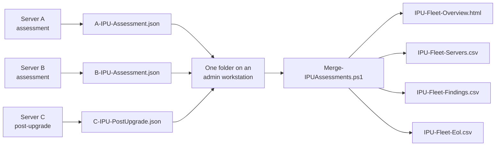

# User guide: fleet overview

For the administrator who combines the results of many servers into one overview. Part of the [user guide](user-guide.md). The other parts: [run the assessment](user-guide-run.md), [read the result](user-guide-read-result.md), [test and contribute](user-guide-develop.md).

## Combining many servers: fleet overview

`src/Merge-IPUAssessments.ps1` (version 1.4.1, for assessment 4.0.1 and later) reads the result JSON of every
server in a folder and writes **one overview** for the whole estate. It is read-only for the input files.



**Where it runs:** an admin workstation or jump host with Windows PowerShell 5.1 or PowerShell 7. **Not** on the
assessed servers. Collect the result JSON files from the servers into one folder first (with the approved SA file-retrieval
process).

### Running it

```powershell
# Read every result in D:\IPU\Results; write the overview next to them
.\Merge-IPUAssessments.ps1 -InputFolder 'D:\IPU\Results'

# Separate output folder, pre-upgrade results only
.\Merge-IPUAssessments.ps1 -InputFolder 'D:\IPU\Results' -OutputFolder 'D:\IPU\Overview' -Mode Pre

# Comma-separated CSVs instead of semicolon
.\Merge-IPUAssessments.ps1 -InputFolder 'D:\IPU\Results' -Delimiter ','
```

| Parameter | Default | Meaning |
|---|---|---|
| `InputFolder` | required | Folder with the `*-IPU-Assessment.json` and `*-IPU-PostUpgrade.json` files |
| `OutputFolder` | the input folder | Where the four output files are written. A folder the merge creates gets access for SYSTEM, Administrators and you only; an existing folder is not changed, but you get a warning when Everyone, Authenticated Users or Users can read it (#128) |
| `Mode` | `All` | `Pre`, `Post` or `All`: which kind of result JSON to include |
| `IncludeRedacted` | off | Redacted copies (`REDACTED-...`) have placeholder names, so they cannot be matched to their originals and would show the same server twice. When the folder also holds original results, the redacted copies are skipped and the console says how many; this switch keeps them. A folder with only redacted results is used as it is |
| `Delimiter` | `;` | CSV separator. `;` opens in columns in Excel where the list separator is `;` (common in European regional settings); use `,` where it is `,` |
| `EolSnapshot` | blank | The end-of-life snapshot file (`eol-snapshot.json`). Blank = next to the script, then in the input folder. Without a snapshot the products are listed as *not checked* (see [End-of-life data](#end-of-life-data)) |

The console prints a one-line summary (`Servers`, `Findings`, `Unreadable files`), a second line when redacted copies were skipped, and the paths written.

### What it produces

| File | Contents |
|---|---|
| `IPU-Fleet-Overview.html` | Cards with overall counts, a **Teams needed** summary (one row per team with the servers that need it, see below), a **Servers (worst first)** table with a *Teams needed* column, the **most common SPECIAL/BLOCKER/ACTION items** across the fleet with which servers have them, and a list of any files it could not read |
| `IPU-Fleet-Servers.csv` | One row per server and mode: `ComputerName`, `Mode`, `Overall`, `Special`, `Blocker`, `Action`, `Warning`, `Manual`, `Target`, `CurrentOS`, `UpgradePath`, `InstallationMedia`, `Platform`, `DomainRole`, `SqlServer`, `CompatScan`, `CDrive`, `Activation`, `Nla`, `TopIssues`, `NotAssessed`, `Partial`, `Redacted`, `Completed`, `CollectorVersion`, `SourceFile`, `EndOfLifeProducts`, `TeamsNeeded` (one field, for example `PKI Team, DBA Team (SQL Server)`) |
| `IPU-Fleet-Findings.csv` | One row per SPECIAL, BLOCKER, ACTION, WARNING or MANUAL finding: `ComputerName`, `Mode`, `Status`, `Area`, `Item`, `Value`, `Details`, `Recommendation`, `Command`, `Link`, `SourceFile`. Filter and pivot it in Excel |
| `IPU-Fleet-Eol.csv` | One row per product and version with an end-of-life date that the servers reported (4.6.0): `Status`, `Product`, `Version`, `Release`, `State`, `EndOfLife`, `DaysLeft`, `ServerCount`, `Servers`, `Text`. Checked against `eol-snapshot.json`; without it every row is MANUAL (not checked) |

### How it decides

- **Newest wins.** If a server has several results for the same mode, only the newest (by `Completed`) is used. A server can still appear twice, once for Pre and once for Post, when `Mode` is `All`.
- **Worst first.** Servers are sorted `SPECIAL`, `BLOCKER`, `ACTION`, `WARNING`, `MANUAL`, `OK`, then by name.
- **`TopIssues`** lists the BLOCKER and ACTION findings for that server. **`NotAssessed`** lists checks that did not complete, and checks that were not run because a check they need did not complete (checks skipped by design are not counted).
- **Partial results** are shown with a `partial` marker: the slow checks had not finished on that server.
- **Unreadable files** (not valid JSON, or a `Schema` other than `IPU-Assessment/1`) are listed in the report and skipped. They do not stop the run.
- If no matching files exist, the script stops with `No *-IPU-Assessment.json or *-IPU-PostUpgrade.json files found`.

> The overview and CSVs describe every server in detail. Treat them as sensitive and keep them out of shared
> locations.

### Teams needed

Besides the Windows Team, which does the upgrade, some servers need another team. The overview shows which ones, per
server (column *Teams needed*, and `TeamsNeeded` in `IPU-Fleet-Servers.csv`, one field such as
`PKI Team, DBA Team (SQL Server)`) and as a summary at the top: one row per team with the number of servers, which
servers, and the items that called for it. An empty value means no other team was found by these rules; it does not
replace reading the server's own report.

| Team | When |
|---|---|
| PKI Team | A Certification Authority (`PKI / CertificationAuthority`, `ADCSRoleServices`), or the PKI site policy row |
| AD Projects | A domain controller (`DOMAIN_CONTROLLER`, or the SPECIAL *Domain controller* row) |
| Windows Projects | A SPECIAL cluster node: the base cluster. What runs on the cluster (SQL, for example) adds its own team |
| DBA Team (type) | A database engine, with the type in brackets: SQL Server (`SQL` rows), Oracle (the database service, not a client-only install), MySQL, PostgreSQL, Db2. Several types: `DBA Team (SQL Server/Oracle)` |
| Exchange | An Exchange BLOCKER or ACTION |
| Team Backup | Backup infrastructure only: a backup server, proxy, storage agent or media agent (Veeam Backup & Replication, a Veeam proxy, a Spectrum Protect server or storage agent, a Commvault MediaAgent). A plain backup client is the Windows Team's |
| Security Team (AV) | An antivirus/EDR agent or security tool to check for the target (`ANTIVIRUS` or `SECURITY` WARNING, not AppLocker, Secure Boot, TPM, BitLocker or filter drivers). The Windows Team deploys the agent; the backend and policy are the Security Team's |
| Network Team | A switch-dependent NIC team (LBFO mode LACP or Static): the switch ports are changed before the upgrade and back after it |
| VDI / Endpoint Team | A VDI host (Citrix VDA, Horizon Agent): no in-place upgrade, the server goes to that team (#376) |
| Application owner | An application past end of life (`EOL:` WARNING) |

Not listed, because the Windows Team does it: VMware Tools, Remote Desktop Session Host and Licensing, IIS (the
application team only when it is complex), a switch-independent NIC team, static routes, failed VSS writers, the
monitoring agent. The customer or application owner who signs off is found in the CMDB or through the Customer
Solution Architect, not from the server.

The rules are one table, `$script:TeamRules` in `src/merge/15-teams.ps1`. A site with other teams, or other names
for them, edits that table and rebuilds the script (`build/Build-Script.ps1 -Manifest src/merge/manifest.txt
-OutputPath src/Merge-IPUAssessments.ps1`, see [docs/build.md](build.md)). Each rule names the team, the result
`Area` and `Item` (regular expressions), the statuses that count, and optionally a pattern for the value or the
details, and a word shown after the team name (the database type).

### End-of-life data

`Get-IPUEolStatus.ps1` says whether a product version (a Windows Server release, SQL Server, PHP, .NET and others) is
still supported, gets security fixes only, ends soon or has ended. It runs on a workstation, never on an assessed
server. The assessment and the fleet overview use the same rules ([ADR 0003](adr/0003-end-of-life-lookup-architecture.md)):
one shared source part is built into all three scripts.

- **Where the data is.** The release zip contains `eol-snapshot.json` next to the scripts (in the repository it is
  `src/eol-snapshot.json`, next to the scripts there too). It is a copy of [endoflife.date](https://endoflife.date)
  data, MIT-licensed; the licence notice is inside the file.
- **The assessment script finds it.** The assessment script looks for `eol-snapshot.json` in the folder of
  `-EolSnapshotPath`, then next to the script, then in `-ReportDirectory` (a file read, no network call) and shows one
  row, *EOL snapshot*, under *Installed applications*: the snapshot date, or, when none is found, where it looked. A
  snapshot older than six months, or one that cannot be read, is MANUAL. With a snapshot, every product it found gets
  its own row, *EOL: <product> <version>*: past end of life is a WARNING, ending soon (within 180 days) or security-only
  is INFO, supported is OK, and a product the snapshot cannot place is unknown, shown as MANUAL, never "supported". When SA deploys only
  the `.ps1`, copy `eol-snapshot.json` to the server next to it.
- **The fleet overview.** `Merge-IPUAssessments.ps1` reads the EOL snapshot next to itself (or in the input folder, or
  `-EolSnapshot <file>`), compares the products of all servers (`EolCandidates` in the results) and adds a section
  *End-of-life products* to the overview with the verdict, the servers, the snapshot date and the attribution line, the
  file `IPU-Fleet-Eol.csv`, a column `EndOfLifeProducts` in the servers CSV, and the findings the server's own report
  did not already have. Without a snapshot the products are listed as *not checked*. Results from before 4.6.0 have no
  product list.
- **Which products.** The assessment records the products it finds in the result JSON as `EolCandidates` (check `eolcandidates`): SQL Server, MySQL, MariaDB, PostgreSQL, MongoDB, Oracle Database, Db2, Redis, Apache HTTP Server, Tomcat, nginx, PHP, .NET, .NET Framework, PowerShell, Python, Node.js, OpenSSL and the Java builds endoflife.date tracks. It reads uninstall entries, service executables, file version resources, the usual folders for PHP, Apache, nginx and OpenSSL, and the .NET Framework registry value. It never runs a product to ask for its version. A product in an unusual folder with no service and no uninstall entry is not found: an empty list means none found, not none installed.
- **How old it may be.** A tool release is only published when the EOL snapshot is at most six months old. A snapshot older than
  `-MaxAgeMonths` (default 6) cannot confirm that a release is still supported: that verdict becomes unconfirmed (MANUAL), while
  end-of-life verdicts still show.
- **Use it.** `.\Get-IPUEolStatus.ps1 -Product php -Version 8.2.12 -SnapshotPath .\eol-snapshot.json`
- **Refresh it by hand.** On a machine with internet access: `.\Get-IPUEolStatus.ps1 -Update -SnapshotPath .\eol-snapshot.json`.
- **Refresh in the repository.** The "EOL snapshot" workflow runs on the first of each month (and on demand), and opens a
  pull request when the data changed. A maintainer reviews and merges it.
