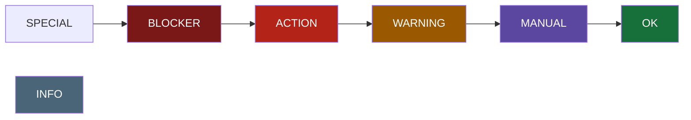
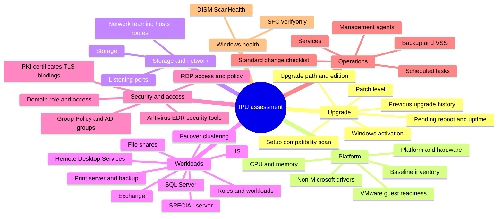

# User guide: read the result

For the change team that reads a result and decides, and anyone who verifies an upgrade afterwards. Part of the [user guide](user-guide.md). The other parts: [run the assessment](user-guide-run.md), [fleet overview](user-guide-fleet.md), [test and contribute](user-guide-develop.md).

## Contents

- [Outputs](#outputs)
- [Reading the report](#reading-the-report)
- [What is checked](#what-is-checked)
- [Post-upgrade verification](#post-upgrade-verification)

## Outputs

For computer `SRV01`:

| Mode | Files in `ReportDirectory` |
|---|---|
| Pre | `SRV01-IPU-Assessment.html`, `.json`, `.log` |
| Post | `SRV01-IPU-PostUpgrade.html`, `.json`, `.log` |

The report is written **twice**: a `PARTIAL` checkpoint after the fast checks, and the final report after the
slow checks. If the job is stopped early, the checkpoint still exists and is marked `PARTIAL`.
Files are written to a `.writing` temp name and renamed, so a half-written report is never left in place.

### The SA result line

One semicolon-delimited line follows a header on stdout:

```
ComputerName;RunStatus;AssessmentStatus;ReportPath;LogPath;ReportSizeKB;Records;Started;Completed;Duration;CollectorVersion;Message
```

| Field | Values |
|---|---|
| `RunStatus` | `SUCCEEDED` or `FAILED` (the assessment script itself, not the server's readiness) |
| `AssessmentStatus` | Overall: `SPECIAL`, `BLOCKER`, `ACTION`, `WARNING`, `MANUAL`, `OK` |
| `LogPath` | The run log; empty when no log could be written (for example a report folder the account cannot write to) |
| `Message` | `Mode=Pre, Checks=38, NotCompleted=0, Skipped=4, JSON=...`. **NotCompleted** counts the checks that left a gap: failed, ran out of time, or were not started because the slow-check budget was used up. **Skipped** counts checks not run by choice or that do not apply: DISM or SFC switched off, no installation media, not a print server, a SPECIAL short report. Before 4.7.0 both were counted as NotCompleted |

Process exit code: `0` when the report was written, `1` when the assessment script failed. A `BLOCKER` assessment still
exits `0`; read `AssessmentStatus`.

### Sharing a report: redaction

Reports describe a server in detail. To share one outside the team (a vendor, a ticket, a public bug report),
run with `-RedactReport 1` (or `$true` on a console). In the HTML and JSON, these are replaced with placeholders that stay the same
within one run (the same address is always `IP-3`):

| Replaced | Placeholder | Example |
|---|---|---|
| Computer name and host names in any domain (IIS bindings, backup and KMS servers, ...), except public documentation and vendor sites such as `learn.microsoft.com` | `HOST-n` | `srv01.corp.example.test`, `shop.customer.example` |
| Domain name and NetBIOS domain | `DOMAIN-n` | `corp.example.test`, `CORP` |
| IPv4 and IPv6 addresses (not masks, `127.0.0.1`, `0.0.0.0`, `::1`) | `IP-n` | `10.20.30.40`, `fe80::1c2d:...` |
| MAC addresses | `MAC-n` | `00:50:56:AB:CD:EF` |
| Accounts: `DOMAIN\user`, `user@domain`, local group members, and the bare names of service and scheduled-task accounts wherever they appear | `ACCOUNT-n` | `CORP\svc_batch`, `adm-jdoe` |
| GPO names (not *Default Domain Policy* and *Local Group Policy*) | `GPO-n` | `Web Server Lockdown` |
| WMI filter names, OU names in Group Policy link paths and distinguished names | `NAME-n` | `.../Servers/Web` |
| Domain SIDs (well-known SIDs such as `S-1-5-32-544` are kept) | `SID-n` | `S-1-5-21-...-500` |
| Certificate thumbprints and subject/issuer names and fields (all but the country code `C=`) | `CERT-n`, `NAME-n` | `CN=srv01.corp...`, `L=<city>` |

Kept: well-known accounts (`BUILTIN\...`, `NT AUTHORITY\...`, `LocalSystem`), versions, file and registry paths, product
names, ports, WMI filter query text, and the country code of certificate subjects (`C=`). Since 4.5.3 the other
subject fields (`L=`, `S=`, `STREET=`, `PostalCode=`, `E=`, `SERIALNUMBER=`) are replaced too: a city can identify
a customer (#212).

A four-part number is kept as a version when its surroundings say so: after *version*, *ver*, *build*, *release*,
*rev* or *update* (also in a `Version=` field), before `(x64)` or `x86`, or when it starts with 0. A bare four-part
number after a product name looks exactly like an address and is replaced (#243).

> **Redaction is best effort.** It recognises the patterns above and the names the script itself collected
> (accounts, GPO names). Company words inside product, task or file names, or an unusual format, can stay visible.
> **Read a redacted report before you share it.**

**Redact a report that already exists.** To share a report you already have, without running the assessment script again:

```
powershell.exe -NoProfile -ExecutionPolicy Bypass -File C:\Temp\Windows-IPU-Readiness-Assessment.ps1 -RedactExisting C:\Temp\IPU-Assessment
```

It writes a `REDACTED-<time>-...` copy of every `*-IPU-Assessment` and `*-IPU-PostUpgrade` report pair (JSON and HTML, and the run log `.log` when it is next to them, #329) in the folder, or of one report when you give a file, in a few seconds. Nothing is collected, and the originals are not changed. The names to redact come from the report itself: the computer, the domain, task and service accounts, and GPO and WMI filter names. Reports that are already redacted are skipped. All reports in one folder share one placeholder map: a server keeps the same placeholder (for example `HOST-2`) in its pre- and post-upgrade copy, and the placeholder is part of the file name, so the copies can be paired and merged into a fleet overview. Use `-RedactReport $true` when you run a new assessment; use `-RedactExisting` for reports you already have.

What changes with redaction:

- The HTML and JSON are named `REDACTED-<yyyyMMdd-HHmmss>-IPU-Assessment.*` (or `-IPU-PostUpgrade.*`), so the
  file name does not reveal the server. The SA result line keeps the real computer name.
- **The log** (#329): the run log `<Computer>-IPU-Assessment.log` stays **unredacted**, because you need it to
  troubleshoot. At the end of the run a redacted copy is written beside the redacted reports, with the same name and
  `.log`, and the same placeholders as the report (`HOST-1` in the log is `HOST-1` in the report). Lines logged after
  the final report are not in the copy. `-RedactExisting` does the same for a log next to an existing report.
  Share the `REDACTED-*.log`, never the original.
- The JSON has `"Redacted": true`. A redacted result JSON **cannot** be the post-upgrade baseline: placeholders cannot
  be compared with the real server, and the post-upgrade run says so. Keep a normal (unredacted) pre-upgrade run
  for the comparison and redact a second run, or only the copies you share.
- The key to the placeholders is written next to the redacted copies (see below), and nowhere else.
- The fleet overview shows each redacted file as its own row, marked `redacted`.

**The redaction key.** With redaction, the script also writes the redaction key, a file that says which placeholder stands
for which original (#211), so the team can map answers about a redacted copy back to the real servers:

- `-RedactExisting`: `DO-NOT-SHARE-REDACTION-KEY-<time>.csv` in the same folder, one file for all the copies made in
  that run (they share one placeholder map, so `HOST-2` means the same server in every copy).
- `-RedactReport 1`: `DO-NOT-SHARE-<Computer>-IPU-Assessment-REDACTION-KEY.csv` (or `-IPU-PostUpgrade-`) next to
  the report.

It is a `;` separated file with `Placeholder;Kind;Original` (for example `HOST-1;HOST;SRV-APP01`) that opens in Excel,
non-ASCII names included. Only SYSTEM, Administrators and the account that ran the script can read it. **It holds the
real names: keep it in the team, and share only the `REDACTED-*` files, never the whole folder.** Switch it off with
`-WriteRedactionKey 0`.

### JSON shape

Schema id `IPU-Assessment/1`. Top-level keys: `Schema`, `CollectorVersion`, `ComputerName`, `Mode`,
`TargetServerVersion`, `Started`, `Completed`, `UtcOffset`, `Partial`, `Redacted`, `Overall`, `Counts`, `Facts`, `Special`,
`Results`, `CheckRuns`, `Snapshot`, `EolCandidates` (each one is described in [result-schema.md](result-schema.md)). `Results[]` has `CheckId, Area, Item, Status, Kind, Value, Details, Recommendation,
Source, Command, CommandKind, Link, LinkTitle`.
The `Snapshot` field (the server snapshot) is what the post-upgrade run compares against. The fleet overview script ([Combining many servers](user-guide-fleet.md#combining-many-servers-fleet-overview)) reads the same
files and accepts only `Schema` = `IPU-Assessment/1`. Every field is described in
[result-schema.md](result-schema.md); the formal JSON Schema is [result-schema.json](result-schema.json), and
[samples/sample-result.json](samples/sample-result.json) is an example.

## Reading the report

### Status



Most severe on the left. The **overall status is the most severe *finding***.

| Status | Do this |
|---|---|
| `SPECIAL` | Not a standard in-place upgrade (cluster node, domain controller): it needs its own plan, extra time and coordination, see [SPECIAL: cluster nodes and domain controllers](user-guide-run.md#special-cluster-nodes-and-domain-controllers) |
| `BLOCKER` | Resolve before scheduling. Examples: unsupported path, a VDI host, a PKI server whose target the site policy does not allow, unsupported SQL/Exchange combination |
| `ACTION` | Complete as part of the change. Example: a feature that Setup will remove |
| `WARNING` | Plan for it. Example: stale patch level, long uptime |
| `MANUAL` | A person must check. Includes things a script cannot prove and **any check that failed to run** |
| `OK` | Checked and fine |
| `INFO` | Context only |

### Result kinds

| Kind | Affects overall? | Purpose |
|---|---|---|
| Finding | Yes | `SPECIAL`, `BLOCKER`, `ACTION`, `WARNING`, `MANUAL` |
| Observation | No | Visible status without changing the overall status |
| Checklist | No | Standard change-procedure steps, listed separately |
| Evidence | No | Inventory and documentation |

### Report layout

- **Hero**: computer, target, times, collector version, overall badge.
- **Cards**: counts per finding status.
- **Summary**: the key facts, among them source release and target release, upgrade path and installation image, activation, platform, domain role (or workgroup), AD location (OU), UAC, SQL Server, endpoint protection, RDP access and C: drive. It is followed directly by **Status meaning**, which explains each status before the tables use them.
- **Chapters** (collapsible, one per area group, listed in [What is checked](#what-is-checked)): a chapter opens by itself when it holds a finding to act on (BLOCKER, ACTION, WARNING or MANUAL). The others hold inventory and evidence and start closed. Use *Expand all* / *Collapse all* above the chapters. Printing or saving as PDF includes every chapter.
- **Counters**: the BLOCKER, ACTION, WARNING and MANUAL counters at the top are links to the rows behind them; *Checklist items* and *Checks run* link to the checklist and to *Collector coverage*.
- **Banners**: `PARTIAL REPORT` (slow checks unfinished) and `Not fully assessed` (a check failed, ran out of time, or was not started because the time budget was used up; the results for that area may be incomplete).
- **Commands and links**: many recommendations show the exact command for this server, labelled **Check** (read-only, safe to run any time) or **Change** (changes the server: run it in the change window, after reading it). The *Copy* button copies it; in print the command is shown as text. The script itself never runs these commands. Where the right action depends on a vendor, there is a *Read more* link to the official page instead. A setting that comes from Group Policy says so, because a local command would be overwritten: change the GPO.
- **Not run by choice** (grey note): a check that was switched off or needs something that was not given, for example the Setup compatibility scan without installation media. The note says what to do if you want it included. It is not a problem.
- **Findings table**: status, area, item, finding, **what to do**.
- **Collector coverage**: every check, its outcome and duration. Read this before trusting an empty area.

> If a check shows `Failed` or `Skipped`, an empty section is **not** evidence of readiness. Review it by hand.

## What is checked

The [checks reference](checks.md) lists every check with what it looks at and the results it can produce.

38 checks. Fast checks run first; the slow ones (print server backup, DISM, SFC, Setup compatibility scan) run after the checkpoint report.



| Chapter in the report | Covers |
|---|---|
| Upgrade Path, Licensing and Windows Health | Supported path, edition and installation image, source end of support, activation and what the target needs for the current activation channel, pending reboot, patch level, DISM, SFC, Setup scan, upgrade history |
| Workloads and Applications | Exchange, SQL Server, domain controller, roles and features, file shares, installed applications, removed or deprecated features |
| Hardware and Virtualization | Physical or virtual, VMware Tools and vSphere versions, non-Microsoft drivers, CPU and memory |
| Storage | Volumes, free space, system and recovery partitions |
| Clustering | Failover cluster membership |
| Network | Adapters (IPv4 and IPv6, gateway, DNS servers and suffix, DNS registration, WINS, NetBIOS over TCP/IP, metric, VLAN), teaming, hosts file (each active line is judged: see [Hosts file](#hosts-file)), static routes, listening ports; a local copy of the network configuration and the hosts file |
| Access and Remote Desktop | Domain or workgroup membership, secure channel, UAC, local administrators, Group Policy (applied and filtered GPOs, OS-dependent WMI filters, last applied), the computer's AD groups and OU path, RDP and NLA, local policy evidence |
| IIS and Remote Desktop Services | IIS, RDS roles |
| PKI and Certificates | CA role, certificates and TLS bindings |
| Security and Antivirus | AV and EDR (Defender, TrendAI/Deep Security, CrowdStrike, SentinelOne, ...), Sysmon, other tools |
| Management Agents | OpenText SA, Universal Discovery, Operations agents |
| Backup and Recovery | Commvault, IBM Spectrum Protect, Veeam, VSS writers |
| Services and Scheduled Tasks | Services of interest, non-Microsoft tasks |
| Assessment and Collector | Change checklist, collector coverage, metadata |

Detection of products is data-driven (a table of names, services and filter drivers near the top of the script),
so when a vendor renames a product you edit the table, not the logic.

### IIS configuration copy

When IIS is installed, the assessment script copies the files in `%windir%\System32\inetsrv\config` (`applicationHost.config`,
`administration.config`, `redirection.config`, ...) into `<EvidenceRoot>\IIS\<Computer>-IPU-IIS-<time>` and zips it.
These are the files `appcmd add backup` saves. IIS itself is not touched. The folder gets SYSTEM and Administrators access
only, because `applicationHost.config` can contain encrypted passwords. The report shows where the copy is and the
SHA-256 of `applicationHost.config`.

The copy is from assessment time. **Immediately before the upgrade**, also run:

```
%windir%\system32\inetsrv\appcmd.exe add backup PreIPU
```

To restore from the evidence copy: stop IIS (`iisreset /stop`), copy the files back to `%windir%\System32\inetsrv\config`,
and start IIS again. Or copy them into a new folder under `%windir%\System32\inetsrv\backup` and run
`appcmd restore backup <folder name>`. If the server uses **shared configuration** (`redirection.config` points to a
share), the report says so: back up the files on that share as well.

### Hosts file

A hosts entry silently overrides DNS, so after an upgrade, or when a server is replaced, a wrong one is among the first
things to break. The `network` check reads the file (read-only, offline: no name is resolved and nothing is pinged)
and judges every active line (#412). One row per line, `Hosts line <n>`, where `<n>` counts all lines of the file:

| Line | Status |
|---|---|
| A name of this server (bare, or with the domain), the name of the domain, or the name of a domain controller | `WARNING` |
| The same name with another address on an earlier line (Windows uses the first line only; an IPv4 and an IPv6 address for one name are fine) | `WARNING` |
| A name sent to loopback or `0.0.0.0` ("blocks the name"; `localhost` itself is normal) | `INFO` |
| The first word is not an IP address, or no name follows the address | `MANUAL` |
| Any other line | `INFO` |

The row `HostsFile` stays `MANUAL` while there is at least one active entry (confirm owner and purpose), is `OK` when
there is none, `INFO` when the file does not exist, and `MANUAL` when it cannot be read. Domain controller names are
checked only when the run has them; an ordinary member server does not collect them, so there such an entry is listed
but not flagged. The reasons never repeat the name; the names are in the details of the row, which redaction handles
as before. The post-upgrade run reports entries that are gone (`WARNING`) and entries that are new (`INFO`); a changed
entry shows as one of each.

### Network configuration copy

The `network` check saves the output of read-only commands into `<EvidenceRoot>\Network\<Computer>-IPU-Network-<time>`
and zips it (#149):

| File | Command |
|---|---|
| `ipconfig-all.txt` | `ipconfig /all` |
| `route-print.txt` | `route print` |
| `netsh-ipv4-show-config.txt` | `netsh interface ipv4 show config` |
| `netsh-interface-dump.txt` | `netsh -c interface dump` |
| `hosts.txt` | a copy of the hosts file (`drivers\etc\hosts`); its SHA-256 is in the `NetworkEvidence` row (#412) |
| `adapter-advanced-properties.txt` | `Get-NetAdapterAdvancedProperty` (offloads, jumbo frames, VLAN), when the NetAdapter module is there |

Each command has a 60-second timeout. A command that fails or times out makes the row `MANUAL` and is named in it; the
others are still saved. The folder gets SYSTEM and Administrators access only.

This copy is **not redacted** and is never part of the report or of `-RedactExisting`: it holds every address on the
server. **Copy it off the server before the change** (together with the report), and do not share it outside the team.

If the upgrade resets an adapter, use the files to put the configuration back by hand. `netsh-interface-dump.txt` is a
netsh script that re-creates the interface configuration. Read it first: it sets every interface, including ones
that are fine, and adapter names may have changed during Setup. To apply it on purpose, as a planned step:

```
netsh -f C:\path\to\netsh-interface-dump.txt
```

The assessment never runs it.

### Print server backup

On a print server (Print Server role installed, or printers shared) the `printers` check lists printers, the ports they
use, drivers, port monitors and print processors (#148). Third-party drivers need the vendor's confirmation for the
target; from 15 January 2026 Microsoft no longer publishes new third-party printer drivers to Windows Update for
Windows Server 2025, but installed drivers keep working
([Microsoft](https://learn.microsoft.com/en-us/windows-hardware/drivers/print/end-of-servicing-plan-for-third-party-printer-drivers-on-windows)).
Third-party port monitors and print processors load into the spooler and are a common cause of failed upgrades: get
the vendor's version for the target first. LPR ports and the LPD Service are deprecated by Microsoft.

The `printbackup` check then exports the whole print configuration (printers, ports, drivers, queues) with
`PrintBrm.exe -B` into `<EvidenceRoot>\Printers\<Computer>-IPU-Print-<time>\<Computer>-printers.printerExport`. PrintBrm
only reads the spooler configuration. The export holds every driver package and can be a few MB or several GB, so it
runs only when the drive has twice the size of `%windir%\System32\spool\drivers` plus 1 GB free; otherwise the row
is MANUAL with the command to run to another drive. PrintBrm first copies the driver packages to a staging folder; the
script points it to a `staging` folder inside this run's export folder (not `%TEMP%` on C:), so the same free-space
check covers it, and removes that folder afterwards. When `EvidenceRoot` is a network path the free space cannot be
read and the row says it was not checked. It is a slow check with a timeout (*PrintBackupTimeoutMinutes*,
also limited by the slow-check budget); a timeout is MANUAL and the partial file and the staging folder are removed.
When the printers could not be read at all, the backup row is MANUAL too: the script does not know whether this is a
print server, and says so instead of skipping the backup as "not a print server".

The file is **not redacted** and is never part of the report or of `-RedactExisting`. **Copy it off the server before
the change**: a backup on C: does not survive a failed upgrade that needs a rebuild.

To restore, on the upgraded server or a new one, as an administrator:

```
%windir%\System32\spool\tools\PrintBrm.exe -R -F <path>\<Computer>-printers.printerExport
```

Add `-O FORCE` to overwrite printers that already exist. Then print a test page on each shared printer and test from a
client. The post-upgrade run reports printers and ports that are gone (ACTION) and printers that now use another driver
(WARNING).

### Standard change checklist

Always listed as `MANUAL` (cannot be proven from inside the guest): backup and fallback, credentials and console
access, target licensing, installation media, application owner sign-off, monitoring and management agents.

## Post-upgrade verification

Run on the same server, with the same `ReportDirectory`, after the upgrade:

```powershell
.\Windows-IPU-Readiness-Assessment.ps1 -AssessmentMode Post
```

It reads `<Computer>-IPU-Assessment.json` from the pre-upgrade run and reports:

- whether the server reached the target release (`ACTION` if it did not, with the Setup log locations to read),
- differences in services (automatic services no longer running, services gone), listening ports, static routes,
  network adapters, printers and printer ports, hosts entries, applications, Windows features, scheduled tasks, applied GPOs,
  file shares and the computer's AD groups,
- a computer object that moved to another OU, a changed UAC setting, and RDP Network Level Authentication turned off (ACTION).

Network adapters are compared one by one, matched by MAC address because Setup can rename them (from a 4.5.0 baseline;
older baselines compare the address lists only). One row per adapter lists every difference: a static adapter that lost
its addresses or gateway, or was switched to DHCP, or a changed VLAN is an ACTION; on a DHCP adapter a new address is a
WARNING; changed DNS servers (order counts), DNS suffix, DNS registration, WINS, NetBIOS or global IPv6 addresses are a
WARNING; a new name or metric alone is INFO. An adapter that is gone is an ACTION. The network configuration copy above
has what you need to restore it.

Changes that come with the new Windows release are listed as INFO, not as problems: services Microsoft now starts on demand or removed, ports that closed with a disabled service, and features removed or renamed (PowerShell 2.0, PowerShell ISE, Defender). Services that are now disabled get their own WARNING, because hardening after the upgrade often disables them on purpose. .NET Framework 3.5 removed by the upgrade is a WARNING with the reinstall command.

If the pre-upgrade JSON is missing, you get a `MANUAL` finding and must compare by hand with the pre-upgrade
HTML. The checklist and Setup compatibility scan are skipped in Post mode.

A list is only compared when both runs actually read it. A list that is not compared is named in a `MANUAL` row, never
shown as "nothing lost" or as "everything lost":

- `BaselineCoverage`: the pre-upgrade run did not collect it (its check did not complete, or the run was a SPECIAL short report).
- `CurrentCoverage`: this run could not read it (its check failed or timed out, or the query behind the list failed). Fix the
  cause shown in the COLLECTOR rows and run Post again, or compare that list by hand.

`Comparison OK` appears only when every list was compared and nothing was lost.

> Keep the pre-upgrade `.json`. It is the baseline.

### Recovery partition after an upgrade

When a server has no recovery (WinRE) partition big enough for the new WinRE, Setup silently shrinks C: and
creates a new recovery partition (about 900 MB) **directly after C:**. That partition blocks extending C: later.

**Prevent it:** start Setup with

```
setup.exe /ResizeRecoveryPartition Disable
```

Microsoft: "Windows does not resize the existing Windows RE tools partition or create a new one during
installation" ([Windows Setup command-line options](https://learn.microsoft.com/en-us/windows-hardware/manufacture/desktop/windows-setup-command-line-options)).
The pre-upgrade report warns when Setup is likely to add the partition, and the checklist shows the switch.
Check afterwards with `reagentc /info`.

**Remove it** (only if C: must be extendable, in a change with a snapshot). The report names the disk and
partition number:

```
reagentc /info              note which partition holds WinRE
reagentc /disable           copies WinRE to C:\Windows\System32\Recovery
diskpart
  select disk <d>
  select partition <n>      the recovery partition AFTER C:
  delete partition override
  select volume c
  extend
  exit
reagentc /enable            WinRE now lives on C:
reagentc /info              must show Enabled
```

- Never skip `reagentc /disable`. Deleting the partition first deletes the only copy of WinRE: the server still
  runs, but has no recovery environment, and `reagentc /enable` then fails.
- Delete only the partition after C:. A recovery partition at the start of the disk is not in the way.
- If WinRE was lost: take `Windows\System32\Recovery\Winre.wim` from `sources\install.wim` on the matching ISO,
  copy it to `C:\Windows\System32\Recovery`, run `reagentc /setreimage /path C:\Windows\System32\Recovery`,
  then `reagentc /enable`.
- Microsoft's procedure for the reagentc and diskpart steps:
  [KB5028997](https://support.microsoft.com/en-us/topic/kb5028997-instructions-to-manually-resize-your-partition-to-install-the-winre-update-400faa27-9343-461c-ada9-24c8229763bf).

The script itself only reads the partition layout and `reagentc /info`; it never changes partitions.
