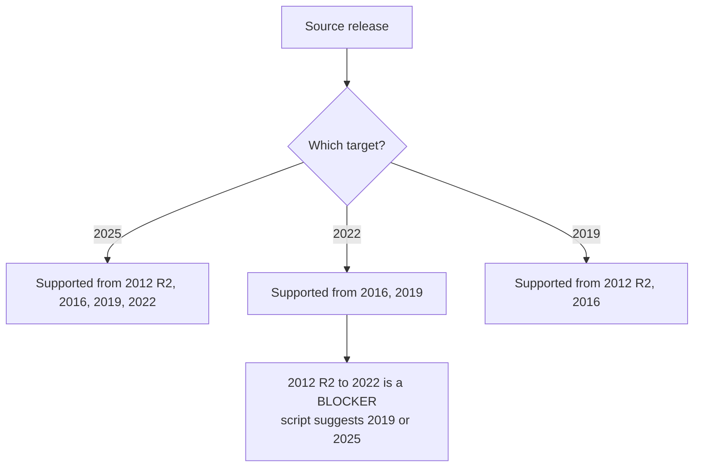
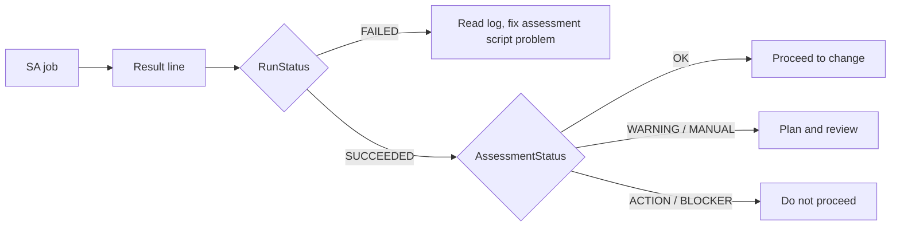

# User guide: run the assessment

For the operator who runs the script on a server, or as a job in OpenText Server Automation (SA). Part of the [user guide](user-guide.md). The other parts: [read the result](user-guide-read-result.md), [fleet overview](user-guide-fleet.md), [test and contribute](user-guide-develop.md).

## Contents

- [Requirements](#requirements)
- [Running the assessment](#running-the-assessment)
- [Parameters](#parameters)
- [Running from OpenText Server Automation](#running-from-opentext-server-automation)
- [Safety and side effects](#safety-and-side-effects)
- [Troubleshooting](#troubleshooting)

## Requirements

| Item | Requirement |
|---|---|
| OS | Windows Server 2012 R2 or later (source) |
| PowerShell | Windows PowerShell 4.0 or later (the script has `#requires -Version 4.0`). Windows Server 2012 R2's own 4.0 is enough. CI checks every change statically against the 2012 R2 / PowerShell 4.0 command and syntax profile; it has no PowerShell 4.0 runner |
| .NET Framework | 4.5 or later (2012 R2 with Windows PowerShell 4.0 always has it; 4.8 recommended) |
| Rights | Administrator. Normally runs as the SA Agent (LocalSystem) |
| Disk | Writable output folder (default `C:\Temp\IPU-Assessment`) |
| Optional | `LGPO.exe` at `C:\Temp\Tools\LGPO.exe` for a restorable local-policy backup |
| Optional | Target installation media (folder, UNC share or `.iso`) for Setup's own compatibility scan |

A 32-bit PowerShell host on 64-bit Windows is handled: the script relaunches itself in 64-bit PowerShell,
because the 32-bit view would give wrong registry and file results. If it cannot relaunch (no file path), it continues
and flags it in the report.

**Prerequisites check.** Before collecting anything, the script checks PowerShell 4.0 or later, .NET Framework 4.5 or later, and administrator rights. If one is missing, it stops at once, and the SA result line says `FAILED` with exactly what is missing and what to do. For example: `Missing: Administrator rights. Run the script elevated (Run as administrator), or as SYSTEM through OpenText SA.` The report contains the same text. If an optional PowerShell module is missing (ServerManager, Storage, NetAdapter, NetTCPIP, ScheduledTasks, Dism, SmbShare), the run continues, and a `MANUAL` row names the module and the checks it affects.

## Running the assessment

Open an elevated PowerShell session on the server.

```powershell
# Default: pre-upgrade, target Windows Server 2025
.\Windows-IPU-Readiness-Assessment.ps1

# Target Windows Server 2022
.\Windows-IPU-Readiness-Assessment.ps1 -TargetServerVersion 2022

# Add Setup's compatibility scan using real media
.\Windows-IPU-Readiness-Assessment.ps1 -TargetMediaPath 'D:\' -TargetMediaLanguage 'en-US'

# After the upgrade
.\Windows-IPU-Readiness-Assessment.ps1 -AssessmentMode Post
```

The scripts are not code-signed (the project has no certificate), so check the hash of the download first
([README, Get the script](../README.md#get-the-script)). If your machine enforces signed scripts and refuses to run
it (`is not digitally signed`), either sign the script with your organisation's certificate or start PowerShell with a
process-scoped bypass: `powershell -ExecutionPolicy Bypass -File .\...ps1`. Do not change the machine-wide policy for
this.

### Choosing a target



Anything else is reported as a `BLOCKER`. For a source with no direct path to any target (**Windows Server 2008 R2**,
2008 or 2012, #276) the row names the shortest documented route, for example *Windows Server 2008 R2 > Windows Server
2012 R2 > Windows Server 2025 (2 in-place upgrades)*, and says that every step is its own change and that a migration
to a new server is usually the better plan. Windows Server 2008 R2 needs Windows Management Framework 4.0 installed to
run the script; Windows Server 2008 (without R2) has no PowerShell 4.0, so the script cannot run there. A **cluster node** and, by site policy, a **domain controller**
(`-BlockDomainControllerIPU`) are reported as **SPECIAL** (see below).

**PKI servers** (a Certification Authority) follow a site policy too: the PKI team allows an in-place upgrade only to
the releases in `-PkiAllowedTargets` (default `2019,2022`). A CA server assessed against 2025 gets a `BLOCKER` that
names the newest allowed release it can reach (2022, or 2019 from 2012 R2) and says that an in-place upgrade to 2025
needs an exception agreed with the PKI team (for example for the last PKI server in the environment). Building a new
PKI on 2025 is a migration, not an in-place upgrade, and is outside this rule (#338).

**VDI hosts** (a Citrix Virtual Delivery Agent, or a VMware / Omnissa Horizon Agent) belong to the VDI / Endpoint Team,
and an in-place upgrade never happens on them (#376). With `-BlockVdiIPU` (on by default) such a server gets a
`BLOCKER` *VDI: <agent>* that says to take it out of the IPU plan and hand it to that team; switched off, it is a
`WARNING` that still names the team. A Citrix Workspace app, Receiver or Horizon Client on its own is not a VDI host.

### SPECIAL: cluster nodes and domain controllers

A SPECIAL server is not a standard in-place upgrade: it needs its own plan, extra time and coordination, and carries
more risk. Tell the project and the customer: **expensive and risky**. The report is short on purpose. It runs only the
checks that describe the server (baseline, upgrade path, activation, platform, CPU and memory, storage, domain, cluster,
and from 4.8.0 SQL Server and PKI, so the fleet overview can name the DBA Team and the PKI Team) and shows a
SPECIAL section with:

- the facts needed to choose a plan (cluster: nodes, roles, SQL Server failover cluster instances, quorum, Cluster
  Shared Volumes, Storage Spaces Direct; domain controller: FSMO roles, global catalog, DNS/DHCP/certificate services
  on the same server, replication summary);
- the risks, in plain words;
- the options to evaluate, each with a Microsoft link (for example Cluster OS Rolling Upgrade, one version at a time;
  a new domain controller beside the old one). These are options, not instructions.

The overall status and the SA line say `SPECIAL`, the JSON has `Overall = SPECIAL` and a `Special` object, and the
fleet overview lists SPECIAL servers first. When the cluster signals disagree (feature, service and registry), the
report says MANUAL instead of guessing.

## Parameters

Parameters are validated before anything runs: thresholds and timeouts must be within sensible ranges (for example 1 to 2048 GB for `MinimumCFreeGB`), paths must be absolute, and `TargetMediaLanguage` must look like a culture name such as `en-US`. An invalid value stops the script with an error and nothing is collected.

Every setting has a default, so the script runs unchanged when no arguments can be passed (such as an SA
ad-hoc job). Override only what you need.

**True/false settings** take `1` or `0` everywhere (`-RunDISMScanHealth 0`). The tables below show the defaults as
`$true`/`$false`, which work on a console but **not in an SA job** (see
[Passing arguments in SA](#passing-arguments-in-sa)).

### Scope

| Parameter | Default | Meaning |
|---|---|---|
| `TargetServerVersion` | `2025` | Destination release: `2025`, `2022` or `2019` (#332) |
| `AssessmentMode` | `Pre` | `Pre` = before the upgrade. `Post` = verify and compare with the baseline (the Pre run's result JSON) |
| `TargetMediaPath` | blank | Folder/drive with `setup.exe`, UNC share, or `.iso`. Blank skips the Setup compatibility scan |
| `TargetMediaLanguage` | blank | Language of the target ISO, for example `en-US`. Blank = the report tells you |
| `BlockDomainControllerIPU` | `$true` | Site policy: a domain controller is reported as **SPECIAL** with a short report (not a standard IPU). `$false` gives the full report with a WARNING instead |
| `BlockVdiIPU` | `$true` | Site policy (#376): a VDI host (Citrix VDA, Horizon Agent) is a **BLOCKER**, owned by the VDI / Endpoint Team and not upgraded in place. `$false` gives a WARNING that names the team |
| `PkiAllowedTargets` | `'2019,2022'` | Site policy (#322, #338): the releases a PKI server (Certification Authority role or `CertSvc`) may be upgraded to in place, comma-separated, with or without quotes (`2019,2022` or `'2019,2022'`; in a profile file a string or a JSON array). Another target is a **BLOCKER**, and the upgrade path never suggests it. `'2019,2022,2025'` lifts the rule |

### Thresholds

These are project values, not Microsoft minimums (unless noted).

| Parameter | Default | Meaning |
|---|---|---|
| `MinimumCFreeGB` | 40 | Free space target on C:. Below it, an `ACTION` finding recommends extending C: |
| `ExtendBlockGB` | 10 | Step size for that recommendation: the shortfall is rounded up to a multiple of this (for example 12 GB short with a 10 GB step recommends 20 GB) |
| `MinimumMemoryGB` | 8 | Below this, a `WARNING` recommends adding memory |
| `MaxPatchAgeDays` | 60 | Warn when the newest security (cumulative) update is older |
| `UptimeWarningDays` | 60 | Warn on long uptime (a reboot is overdue) |
| `GroupPolicyMaxAgeDays` | 7 | Domain members: warn when Group Policy has not applied for longer |
| `AVMaxAgeDays` | 3 | Warn when antivirus signatures are older |
| `CertificateWarningDays` | 90 | Warn on certificates expiring sooner |
| `KmsRenewWarnDays` | 165 | A KMS client with fewer days left than this has missed two renewal windows (activation lasts 180 days, renews every 7): WARNING |
| `SystemPartitionMinFreeMB` | 50 | Minimum free space on the system partition |
| `RecoveryPartitionMinFreeMB` | 250 | Minimum free space on the recovery partition (Microsoft WinRE guidance) |

### Slow checks (time-boxed)

| Parameter | Default | Meaning |
|---|---|---|
| `RunDISMScanHealth` | `$true` | Run `DISM /ScanHealth` (read-only) |
| `RunSFCVerifyOnly` | `$true` | Run `SFC /verifyonly` (read-only) |
| `DISMTimeoutMinutes` | 30 | Cap for the DISM scan |
| `SFCTimeoutMinutes` | 30 | Cap for the SFC scan |
| `SlowCheckBudgetMinutes` | 50 | One budget shared by DISM and SFC (and the print server export, which adds its own `PrintBackupTimeoutMinutes` to it when it applies) |
| `CompatScanTimeoutMinutes` | 45 | The Setup scan has its own clock when `TargetMediaPath` is set: it always gets this long, whatever DISM and SFC used |

When the budget runs out, remaining slow checks are reported as `MANUAL` (skipped), not silently dropped.

If DISM or SFC hits its time limit, the scan can keep running: the work is done by `TiWorker.exe` under the
TrustedInstaller service, outside the process the script stops. The remaining DISM/SFC check is then skipped with a
`MANUAL` row ("a previous DISM or SFC scan timed out and may still be running"), because a second scan on top of the
first gives wrong answers (for example SFC reporting a repair waiting for a reboot). A timeout row also says when the
script could not stop the process at all. The Setup scan is still run.

Only one run can use a report folder at a time. A second run for the same server stops at once with a `FAILED` SA line
("another assessment run on this server is using ...") and writes nothing, so it cannot wipe the first run's log. The
lock is an open file handle on an empty file named after the run log (`<Computer>-IPU-Assessment.log.lock` for a Pre
run, `<Computer>-IPU-PostUpgrade.log.lock` for a Post run), so a run that was killed releases it and a leftover file
blocks nobody. The lock is per mode: a Pre run and a Post run for the same server do not block each other.

### Evidence copies

The evidence copies go into one folder, with a subfolder per topic (#198):

```
C:\Temp\IPU-Evidence\        -EvidenceRoot
  README.txt                 what is here; unredacted, do not share; copy off before the change
  Policy\                    RDP and Group Policy evidence, LGPO backup
  IIS\                       IIS configuration copy
  Network\                   network configuration copy
  Printers\                  PrintBrm backup
```

Each run writes `<Computer>-IPU-<topic>-<time>` folders and ZIPs inside its topic folder. Folders the script creates
get access for SYSTEM and Administrators only. The copies are **not redacted** and never part of the report or of
`-RedactExisting`: copy the folder off the server before the change, and do not share it outside the team. It is
deliberately not inside the report folder, which is retrieved and shared.

| Parameter | Default | Meaning |
|---|---|---|
| `EvidenceRoot` | `C:\Temp\IPU-Evidence` | Root of the evidence copies (layout above) |
| `EnableRDPPolicyEvidence` | `$true` | Collect RDP access and policy evidence |
| `LgpoExe` | `C:\Temp\Tools\LGPO.exe` | Optional. Used only for backup (`/b`) and `/parse`. A missing file skips LGPO; an empty value (`-LgpoExe ''`) switches it off on purpose |
| `PolicyEvidenceRoot` | blank | Blank: the policy evidence goes to `EvidenceRoot\Policy`. Set it to keep the policy evidence in another folder, for example the location used before 4.5.1, `C:\Temp\Tools\PolBackup`. The other copies are not affected |
| `CreatePolicyEvidenceZip` | `$true` | Zip each evidence copy |
| `EnableIISConfigEvidence` | `$true` | When IIS is installed, copy its configuration files into a restricted evidence folder and ZIP under `EvidenceRoot\IIS` (see [IIS configuration copy](user-guide-read-result.md#iis-configuration-copy)) |
| `EnablePrintBackup` | `$true` | On a print server, export printers, ports and drivers with `PrintBrm -B` into a restricted evidence folder under `EvidenceRoot\Printers`; skipped (MANUAL, with the command) when the drive lacks 2 x the size of `spool\drivers` + 1 GB (see [Print server backup](user-guide-read-result.md#print-server-backup)) |
| `PrintBackupTimeoutMinutes` | `30` | Time limit for the export; added to the slow-check budget on a print server (so DISM and SFC keep theirs). A timeout is MANUAL |
| `EnableNetworkEvidence` | `$true` | Save `ipconfig /all`, `route print` and the netsh interface configuration into a restricted evidence folder and ZIP under `EvidenceRoot\Network` (see [Network configuration copy](user-guide-read-result.md#network-configuration-copy)) |

### Output

| Parameter | Default | Meaning |
|---|---|---|
| `ReportDirectory` | `C:\Temp\IPU-Assessment` | Where HTML, JSON and log are written |
| `WriteJson` | `$true` | Write the result JSON (also the post-upgrade baseline) |
| `RestrictOutputAcl` | `$true` | Folders the script creates (report folder, evidence folders) get access for SYSTEM and Administrators only. Existing folders are never changed; the report warns, with the `icacls` command to fix it, if an existing folder is readable by Everyone, Authenticated Users or Users. `$false` keeps inherited permissions |
| `NumberCultureName` | `da-DK` | Culture used to format numbers in the SA result line. Invalid values fall back to invariant. The default is kept for existing SA jobs; set your own in a [profile file](#site-data-files-patterns-and-profile) |
| `EolSnapshotPath` | blank | The EOL snapshot (`eol-snapshot.json`). Blank = next to the script, then in `ReportDirectory`. See [End-of-life data](user-guide-fleet.md#end-of-life-data) |
| `RedactExisting` | blank | A folder or report file: write redacted copies of existing reports and stop (see [Sharing a report: redaction](user-guide-read-result.md#sharing-a-report-redaction)) |
| `RedactReport` | `$false` | Replace names, addresses, accounts, SIDs and certificate details with placeholders in the HTML and JSON, for sharing outside the team. See [Sharing a report: redaction](user-guide-read-result.md#sharing-a-report-redaction) |
| `WriteRedactionKey` | `$true` | With `-RedactReport` or `-RedactExisting`, also write the key that maps each placeholder to its original next to the redacted copies (see [Sharing a report: redaction](user-guide-read-result.md#sharing-a-report-redaction)). Share only the `REDACTED-*` files |

### Site data files

| Parameter | Default | Meaning |
|---|---|---|
| `PatternFile` | blank | Optional JSON file that adds, replaces or disables detection patterns (products, services and drivers the script recognises). See [Site data files](#site-data-files-patterns-and-profile) |
| `ProfileFile` | blank | Optional JSON file with your site's defaults for the settings above. An argument given to the script still wins |

#### Site data files: patterns and profile

Both files are optional. Without them the script behaves exactly as before and writes no extra row. They let
you keep vendor names and site policy outside the script, so the script itself does not need editing when a
vendor renames a product or a site uses other thresholds. Keep them next to the script in SA, or on a share the
computer account can read, and pass the full path.

**All or nothing.** If a file cannot be read, is not valid JSON, has the wrong `Schema`, or contains any
invalid entry, *nothing* from that file is applied: the run uses the built-in values and the report shows a
`MANUAL` finding *Pattern file* or *Profile file* in *Assessment and Collector* with every problem found. When a
file is applied, an `INFO` row lists what it changed and the file's SHA-256, so the report shows which version
was used.

**Pattern file** (`"Schema": "IPU-Patterns/1"`). Top-level keys are the categories `Agents`,
`EndpointProtection`, `SecurityTools`, `Backup`, `Vdi` and `Workloads` (see section 2 of the script for the built-in
entries). Each category is a list of entries:

| Field | Meaning |
|---|---|
| `Label` | Required. The name shown in the report. An entry with the same label as a built-in one (case does not matter) **replaces** it; a new label is **added** |
| `App` | Regular expression for the installed application name |
| `Service` | Regular expression for the service short name |
| `Display` | Regular expression for the service display name |
| `Driver` | Regular expression for a filter or kernel driver name |
| `Disabled` | `true` **removes** the built-in entry with this label |
| `Link`, `LinkTitle` | Optional. A documentation page (https) and its title, shown with the row of a match, for example the vendor's upgrade guidance |

An entry needs at least one of `App`, `Service`, `Display`, `Driver` (unless it disables). Patterns are matched
case-insensitively; keep them specific, because a broad word matches unrelated software.

```json
{
  "Schema": "IPU-Patterns/1",
  "EndpointProtection": [
    { "Label": "Contoso EDR", "App": "^Contoso EDR", "Service": "^CtsEdr$", "Driver": "^CtsEdrFlt$" }
  ],
  "Workloads": [
    { "Label": "Contoso ERP", "Service": "^CtsErp" },
    { "Label": "Boomi", "Disabled": true }
  ]
}
```

**Profile file** (`"Schema": "IPU-Profile/1"`). One object `Settings` with any of these parameters:
`TargetMediaLanguage`, `BlockDomainControllerIPU`, `BlockVdiIPU`, `PkiAllowedTargets`, the thresholds, the slow-check settings
(DISM, SFC, the time budget and the timeouts), the evidence settings (`EvidenceRoot`, `EnableRDPPolicyEvidence`, `LgpoExe`,
`PolicyEvidenceRoot`, `CreatePolicyEvidenceZip`, `EnableIISConfigEvidence`, `EnableNetworkEvidence`, `EnablePrintBackup`,
`PrintBackupTimeoutMinutes`), `WriteJson`, `RestrictOutputAcl`, `NumberCultureName` and `WriteRedactionKey`. Each value must pass the same
checks as the parameter (range, type, absolute path), and a list such as `PkiAllowedTargets` may not be empty. `AssessmentMode`, `TargetServerVersion`,
`TargetMediaPath`, `ReportDirectory`, `RedactReport`, `RedactExisting`, `EolSnapshotPath` and the two file parameters describe one run and cannot
be set in a profile. Settings passed as arguments win; the *Profile file* row names them. `RestrictOutputAcl` from a profile
reaches the evidence folders only: the report folder is set up before the file is read, and the row says so (#261).

```json
{
  "Schema": "IPU-Profile/1",
  "Settings": {
    "MinimumCFreeGB": 60,
    "MaxPatchAgeDays": 45,
    "TargetMediaLanguage": "en-US",
    "NumberCultureName": "en-GB"
  }
}
```

Both examples are in [`docs/examples`](examples/). A JSON backslash must be doubled: `"C:\\Tools\\LGPO.exe"`.

**Defaults that come from one site.** A few defaults reflect the site the tool was first built for:
`NumberCultureName` is `da-DK`, `BlockDomainControllerIPU` is on (a domain controller is SPECIAL, see above), `BlockVdiIPU` is on (a VDI host is a BLOCKER),
`PkiAllowedTargets` is `2019,2022` (the PKI team's current rule), and
`Merge-IPUAssessments.ps1` writes CSV files with `;`. They stay as they are so existing SA jobs that pass no
arguments behave the same (#131). Another site sets its own values in a profile file, for example
`"NumberCultureName": "en-US"` or `"BlockDomainControllerIPU": false`, and runs the merge with `-Delimiter ','` if
its Excel expects commas.

## Running from OpenText Server Automation

The script is designed for SA Ad-Hoc Scripting, normally as the SA Agent (LocalSystem).

1. Paste or attach the script. If your job can pass arguments, use them (see
   [Passing arguments in SA](#passing-arguments-in-sa)); otherwise edit the defaults in the `param()` block.
2. **Set the job timeout** above the slow-check budget:

   `SlowCheckBudgetMinutes` (+ `PrintBackupTimeoutMinutes` on a print server, + `CompatScanTimeoutMinutes` when `TargetMediaPath` is set) **+ about 15 minutes.**
   With defaults that is roughly 65 minutes, or 110 with media.
3. Read the single result line from the job output (`RunStatus`, `AssessmentStatus`).
4. Retrieve the HTML through your approved SA file-retrieval process.

### Passing arguments in SA

SA puts a backtick before every `$` in the parameter field (#337), so `$true` and `$false` reach the script as text and
the job fails before any check runs (`Cannot convert value "System.String" to type "System.Boolean"`).

| Setting | In an SA job | On a console |
|---|---|---|
| True/false | `1` or `0`: `-RunDISMScanHealth 0 -RedactReport 1` | `1`/`0` or `$true`/`$false` |
| A list (`PkiAllowedTargets`) | `2019,2022` or `'2019,2022'` (#340) | the same |
| Text with spaces or a path | in quotes: `-ReportDirectory 'C:\temp\IPU-Assessment'` | the same |

A quick run that skips the two slow health scans, for example to prove the script starts on a server:

```
-AssessmentMode Pre -RunDISMScanHealth 0 -RunSFCVerifyOnly 0
```

SA's own wrapper may print `Set-ExecutionPolicy : Windows PowerShell updated your execution policy successfully, but
the setting is overridden by a policy defined at a more specific scope` before the script starts. That comes from SA,
not from this script, when a Group Policy sets the execution policy (for example `RemoteSigned`). It is harmless:
the script still runs, and the result line that follows is the one to read.



## Safety and side effects

| Does | Does not |
|---|---|
| Write report, log, JSON and evidence files | Install, remove or reconfigure anything |
| `DISM /ScanHealth`, `SFC /verifyonly` | `DISM /RestoreHealth`, `SFC /scannow` |
| `LGPO.exe /b` and `/parse` (if present) | `LGPO.exe /g` or `/m` |
| With media only: mount and dismount an ISO; Setup's `/compat scanonly` creates `C:\$WINDOWS.~BT` | Start an upgrade |
| Query registry, WMI, services, certificates | Query `Win32_Product` (it triggers MSI reconfiguration) |
| `PrintBrm.exe -B` (export only, on a print server) | `PrintBrm.exe -R` (restore) |
| `ipconfig /all`, `route print`, `netsh interface ipv4 show config`, `netsh -c interface dump` (each only prints the configuration) | `netsh -f` or any other netsh command that sets something |

Reports contain a detailed inventory (ports, tasks, certificates, agents). Treat them as sensitive and restrict
access to the output folder.

## Troubleshooting

| Symptom | Cause | Fix |
|---|---|---|
| SA line `FAILED` with `Missing: ...`, nothing collected | A prerequisite is missing: PowerShell 4.0, .NET Framework 4.5 or administrator rights ([Requirements](#requirements)) | Do what the message says (for example run elevated, or install .NET Framework 4.8) and run again |
| `MANUAL` row *Prerequisites* naming a module | An optional PowerShell module is missing | Install the feature that provides it, or review the named area by hand |
| SA job fails at once: `Cannot convert value "System.String" to type "System.Boolean"` | `$true`/`$false` in the SA parameter field (SA escapes `$`) | Use `1`/`0` (see [Passing arguments in SA](#passing-arguments-in-sa)) |
| SA output starts with `Set-ExecutionPolicy ... overridden by a policy defined at a more specific scope` | SA's wrapper, with a Group Policy that sets the execution policy | Nothing: harmless; read the result line that follows |
| `... is not digitally signed` | Machine enforces signed scripts; the project does not sign its scripts | Check the hash, then sign the script with your own certificate, or `powershell -ExecutionPolicy Bypass -File` for that process only |
| Fleet overview: `No ... files found` | Wrong `InputFolder`, or the files were renamed | Files must end in `-IPU-Assessment.json` or `-IPU-PostUpgrade.json` |
| Fleet overview lists a file under "Files not read" | Corrupt JSON, or not an `IPU-Assessment/1` result JSON | Re-collect the file from the server; check the assessment script version is 4.0.1 or later |
| Fleet CSV opens as one column in Excel | Regional list separator differs from `;` | Re-run with `-Delimiter ','` |
| Report says `PARTIAL REPORT` | Slow checks had not finished (job stopped or timed out) | Raise the SA job timeout above the budget ([Running from OpenText Server Automation](#running-from-opentext-server-automation)) and re-run |
| `Not fully assessed: <check> stopped with an error` | A check hit an unexpected error | See `.log` for the message and line number; review that area manually |
| `Not fully assessed: <check> was skipped (Needs baseline, which stopped with an error)`, many at once, and a `MANUAL` row *Check not run* for each | A check that provides data to others failed (usually `baseline`: the first CIM query, a WMI problem or an access error), so the checks that read its data were not run instead of reporting "not installed" | Fix the cause shown for the named check in the `.log`, then run the assessment again; do not read the skipped areas as clean |
| `Skipped - slow-check time budget used up` | DISM and SFC consumed the shared budget | Run manually, or raise `SlowCheckBudgetMinutes` and the job timeout |
| Application or SQL results look wrong | 32-bit PowerShell host without relaunch | Run from 64-bit PowerShell; the report flags this |
| No before/after comparison | Pre-upgrade JSON missing | Restore `<Computer>-IPU-Assessment.json` into the same folder |
| Source release not recognised | Unknown build number | Report shows `MANUAL`; check the OS build and caption |
| Wrong number formatting in the SA line | `NumberCultureName` | Set a valid culture, for example `en-US` |
| `HTML validation failed` | Report generation produced a truncated document | Re-run; attach the log |

Log lines are `Timestamp;Level;Phase;Message`. Each check logs `Started` and `Finished` with outcome and duration.
