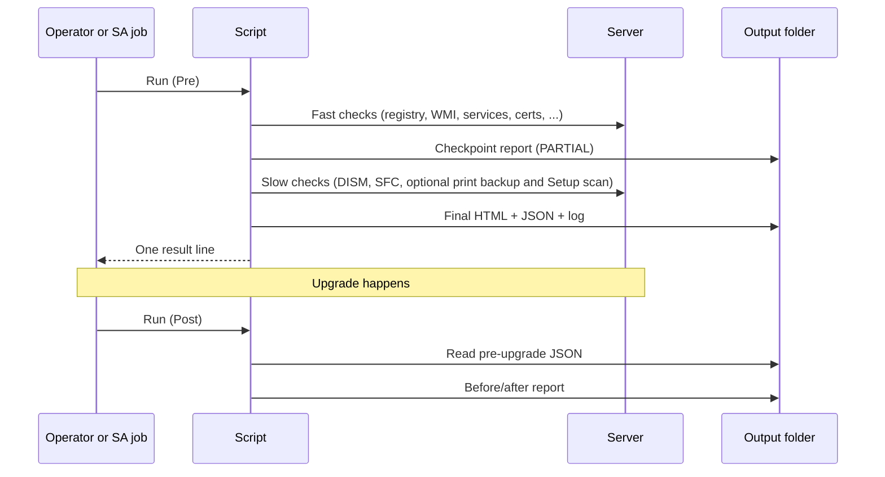
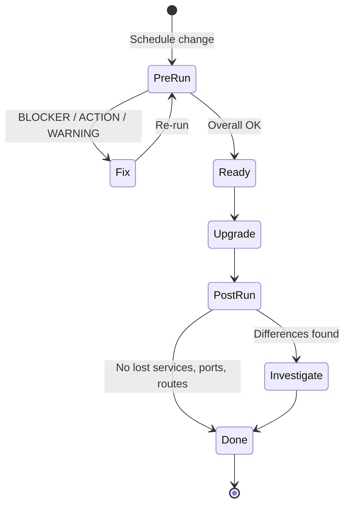

# User guide

How to run the Windows IPU readiness assessment, read its results, and troubleshoot it.

**Scripts:** `src/Windows-IPU-Readiness-Assessment.ps1` (the assessment script, version 4.8.0; runs on each server) and
`src/Merge-IPUAssessments.ps1` (version 1.4.1, combines many servers' results, runs on an admin workstation)
**Audience:** server and change engineers preparing or verifying a Windows Server in-place upgrade.

The guide is split by reader. Start with the part that matches what you are doing:

| You want to | Read |
|---|---|
| Run the assessment on a server: requirements, parameters, site data files, OpenText SA, safety, troubleshooting | [Run the assessment](user-guide-run.md) |
| Read a result and decide: outputs, redaction, statuses, what is checked, the evidence copies, post-upgrade verification | [Read the result](user-guide-read-result.md) |
| Combine the results of many servers: the fleet overview, teams needed, end-of-life data | [Fleet overview](user-guide-fleet.md) |
| Change the scripts or run the tests | [Test and contribute](user-guide-develop.md) |

---

## 1. Overview

The assessment script is **read-only**. It gathers facts from the server, applies Microsoft's published
upgrade rules plus project thresholds, and writes a report. It never changes the server's configuration.

### Typical lifecycle

## Where did a section go?

The guide used to be one file with numbered sections. If you have an old note or link, this is where each section is now:

| Old section | Now in |
|---|---|
| 1. Overview | [Overview](user-guide.md#1-overview) |
| 2. Requirements | [Requirements](user-guide-run.md#requirements) |
| 3. Running the assessment | [Running the assessment](user-guide-run.md#running-the-assessment) |
| 4. Parameters | [Parameters](user-guide-run.md#parameters) |
| 5. Outputs | [Outputs](user-guide-read-result.md#outputs) |
| 6. Reading the report | [Reading the report](user-guide-read-result.md#reading-the-report) |
| 7. What is checked | [What is checked](user-guide-read-result.md#what-is-checked) |
| 8. Post-upgrade verification | [Post-upgrade verification](user-guide-read-result.md#post-upgrade-verification) |
| 9. Combining many servers: fleet overview | [Combining many servers: fleet overview](user-guide-fleet.md#combining-many-servers-fleet-overview) |
| 10. Running from OpenText Server Automation | [Running from OpenText Server Automation](user-guide-run.md#running-from-opentext-server-automation) |
| 11. Safety and side effects | [Safety and side effects](user-guide-run.md#safety-and-side-effects) |
| 12. Troubleshooting | [Troubleshooting](user-guide-run.md#troubleshooting) |
| 13. Running the tests | [Running the tests](user-guide-develop.md#running-the-tests) |
